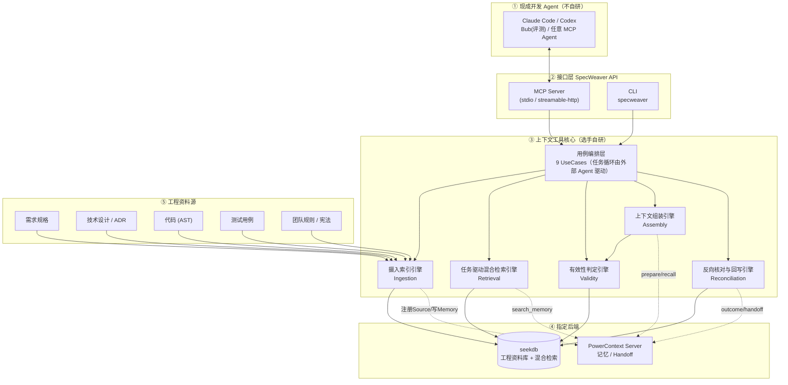
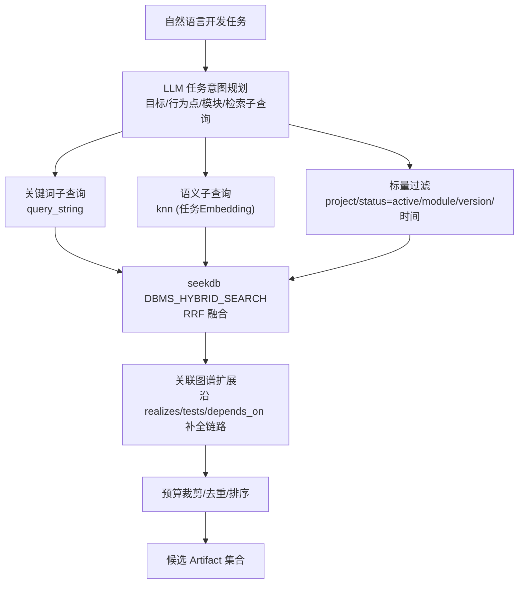
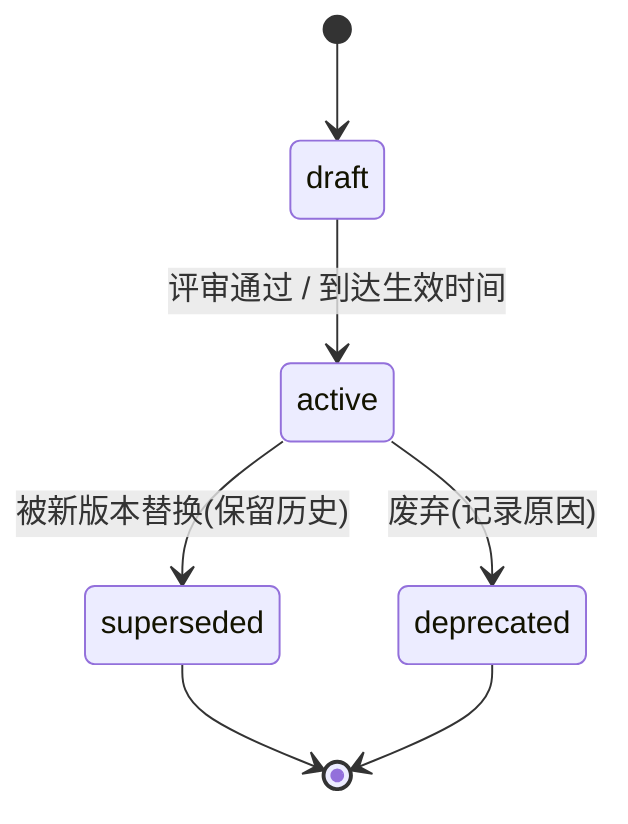
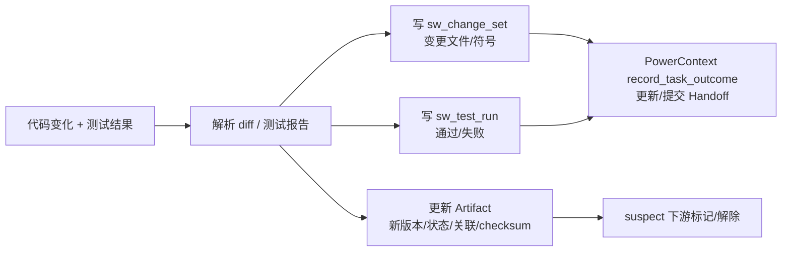
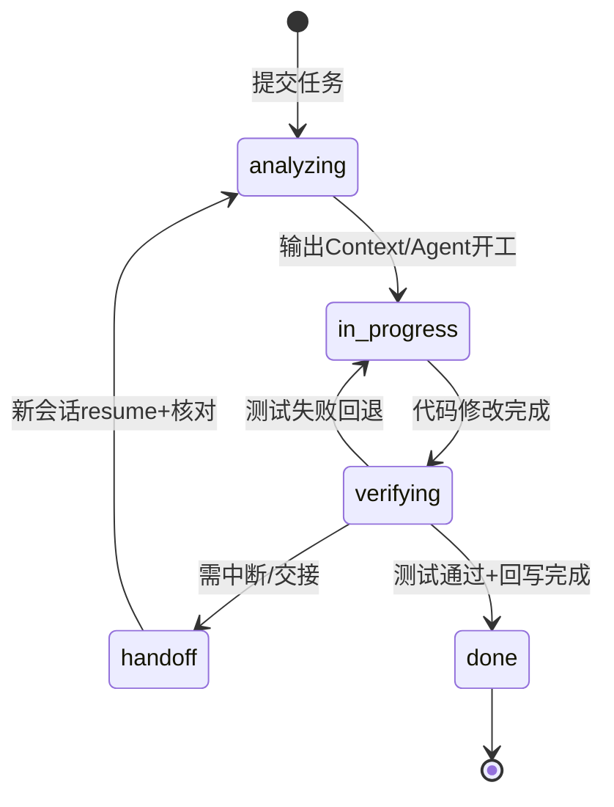

# SpecWeaver（规格织网）整体架构设计说明书

> 第六届 OceanBase 数据库大赛 · MiniMax × OceanBase 赛题「规有所依——面向软件持续演进的 SDD 上下文管理系统」
> 官方原文：[赛题.md](../赛题.md)（语雀建议稿 v0.4 · 2026-09-14，2026-10-21 爬取）
> 版本：v1.1（v0.4 适配增补）　最后更新：2026-10-21（新增 §0.1 状态总览 / §2.5 / §5.5 / §10.5–10.6 / §11.2 与 M7 规划；既有章节的"已交付"结论不受影响）

---

## 0. 阅读导引

本文档是 SpecWeaver 的**架构级定稿**，回答五个问题：

1. 我们要造的到底是什么（第 1 章）；
2. 它如何 1:1 覆盖赛题的职责、交付物与评分点（第 2 章）；
3. 系统由哪些层、模块、数据模型构成，数据如何流动（第 3–8 章）；
4. 如何演示、如何度量效果、如何落地与控风险（第 9–13 章）；
5. 面向赛题 v0.4 的标的适配与评测协议如何落地（§2.5 缺口闭环总表 → §5.5 仓库档案、§10.5–10.6 双轨标的与 TaskPack、§11.2 统一评测产物；均为 M7 规划）。

**核心结论先行**：

- SpecWeaver 是一个**运行时 SDD 工程上下文服务**，对上以 MCP/CLI 接入现成开发 Agent，对下内置两个官方指定后端——**seekdb（存储 + 混合检索）** 与 **PowerContext（记忆 + 任务交接）**。
- 我们**不把 GitHub Spec Kit 当作运行时骨架去"换数据库"**（那在概念上是错的，详见 1.3），而是把 Spec Kit 的**规格模板、项目宪法、检查清单**沉淀为 SpecWeaver 的"规格 Schema 与产出规范"。
- 选手自研的核心价值集中在五个引擎：**摄入索引、任务驱动混合检索、有效性与冲突/缺口判定、上下文组装、反向核对与回写**。
- **标的可插拔（M7）**：铁路教学标的之外，经**仓库档案层**（§5.5）适配 v0.4 §2.4 的参考标的（openspec-demo 图书应用、TS/Playwright 栈）；评测侧以 **TaskPack**（§10.6）声明"独立初始快照 + 固定 Agent + 预算"，以 **EvalRun**（§11.2）产出统一格式的结构化评测产物——Artifact 元模型与五个引擎对此零改动。
- **交付现状一页可查**：✅ 已交付主链路、🟡 已知边界（后续改进）、🔵 M7 规划三张清单统一汇总在 §0.1。

### 0.1 交付状态与后续改进总览（2026-10-21）

标记约定（全文统一）：**✅ 已交付且证据可核对** ｜ **🟡 已交付但有已知边界（= 后续改进清单）** ｜ **🔵 M7 规划（v0.4 适配）** ｜ **⏳ 有设计、未排期**。

**一、运行时主链路（✅）**

| 能力 | 证据（可核对） |
|---|---|
| 五引擎全链路：摄入→检索→有效性→组装→回写→接续 | 269 项测试（263 离线 + 6 真后端，语句覆盖 94%），`scripts/gate.py`（`--live` 下任何 skip 判失败） |
| 11 个 MCP 工具（stdio / streamable-http 双传输 + ToolAnnotations + `/metrics`） | `evidence/m5-20260927-005855/` · `http-transport-20260927-042816/` · `mcp-stdio-config-20260927/` |
| CLI 7 命令（doctor · ingest · context · finish · handoff · resume · version，`--json` / `--usage-out`） | 《03》§7.2 |
| 铁路全链路演示（规格升版 + 中断接续 + 真实回归 13/13） | `evidence/railway-20260927-103203/` |
| 真 Agent 端到端（Claude Code 自主调全 11 工具，独立 judge 17 passed） | `evidence/off-on/20260927-095319/`（含 `transcript.jsonl`） |
| OFF/ON 效率对照（hard 档，N=3） | `evidence/off-on/20260926-235601/` |
| 检索质量金标（生产预算 recall 1.0 vs 朴素关键词 0.847 vs 官方 prepare 0.208） | `evidence/retrieval-railway-*/`（8000-v4 为生产预算终版） |
| 上下文预算对交付文本成立（渲染后复测、循环收敛） | `tests/unit/engines/assembly/test_budget_guarantee.py` |
| 评委 clone-and-run 复现（无 `.env` 自动降级不崩） | `evidence/clone-check-20260927-052153/` |

**二、已交付、有已知边界（🟡，即后续改进清单）**

| 事项 | 边界（如实记录，出处） | 后续动作 |
|---|---|---|
| 紧预算装配 | 1500B 下 recall 0.44–0.46 vs 基线 0.47，接近持平仍略低（§11.1 容量注记） | 设计"按段分配 + 未用额度回收"两阶段分配（尚未设计，不是 bug） |
| 效率统计强度 | OFF/ON 仅 N=3 且 ON 最差一次劣于全部 OFF；真 Agent 端到端 n=1（§2.3/§11.1） | M7 以 TaskPack + run_eval 批量扩 N（§10.6） |
| 记忆侧检索 | 该部署 PowerContext 仅 fts 词面召回、条目无时间戳，Bundle ④段记忆只标内容不标时序（§8.1；《02》§7.6 实测） | 维持现状（语义责任在 seekdb）；官方部署升级后复测 |
| 自动建图证据面 | 五类证据中两类未落地：语义相似度（设计预留）、提交信息（`WorkspacePort` 无日志接口）（§5.3） | commit 证据 ⏳ 未排期；语义建图随 embedding 复用评估 |
| 经验复用链路 | PowerContext propose_experience/skill → approve ⏳ 未排期（§8.1） | 题包评分口径明确后再定 |
| 官方装配基线 | PreparedContext 三方对照第三臂可选、主链路未接（§8.1；`eval_retrieval.py` 已支持 `--prepare` 臂） | 按需启用，不阻塞 |
| 规模成本 | validity gap 全项目扫描使后端调用随语料增长（200 构件 445 次、p95 9.6s，§11.1 表） | 增量化 gap（只扫变更模块）⏳ 未排期——先随 openspec-demo 轨道实测再决定 |
| 运行时安全 | `/metrics` 无鉴权（单机演示姿态） | 共享部署按 `deploy/README.md` 加 enforced + 反代 |
| CLI/MCP 面对称性 | M5 四用例（决策/进度/核对/溯源）仅 MCP 暴露，CLI 未加同名命令（§9.2） | 需要时按既有薄包装模式补命令，工作量小 |

**三、M7 规划（🔵，v0.4 适配，详见 §2.5 缺口闭环表）**

- ✅ **仓库档案层已交付（2026-10-21，M7 第 1 项）**：三档案（specweaver/openspec/plain）+ openspec 方言按条目拍平 + delta→draft/supersedes 版本链 + Tier-2 文本符号索引；`ingest --profile` / `sw_ingest_project(profile=)` 可选覆盖，报告回显生效档案；详见 §5.5 交付注记。openspec-demo 实仓验证仍随"轨道二"进行。
- ✅ **TaskPack 协议已交付（2026-10-21，M7 第 2 项）**：严格 manifest schema（extra=forbid）+ `load/materialize`（快照隔离四维度显式化）+ railway 三层资产 + `scripts/taskpack_check.py` 校验入口；详见 §10.6 交付注记。
- ✅ **EvalRun 已交付（2026-10-21，M7 第 3 项）**：schema + 双布局采集器（railway-demo / off-on）+ `scripts/emit_evalrun.py`；现有 7 份真实证据已回填机读档案（`evidence/**/evalrun.json`）；详见 §11.2 交付注记。
- ✅ **run_eval harness 已交付（2026-10-21，M7 第 4 项）**：读 TaskPack 真跑双臂（clone pinned commit → ON 挂 MCP/OFF 裸跑 → judge → EvalRun），ON/OFF 各 1 次真实冒烟全绿（`evidence/eval-railway-basic-*/`），后端侧用量经 `SPECWEAVER_USAGE_OUT` 捕获；详见 §10.6 交付注记。
- ✅ **openspec-demo 轨道已交付（2026-10-21，M7 第 5 项）**：实仓 a05b36d 摄入 117 工件（32/32 需求命中）+ 三层 TaskPack + ON/OFF 真跑冒烟双绿（ON 44 passed/326 后端调用，OFF 43 passed，`evidence/eval-openspec-demo-basic-*/`）；详见 §10.5 交付注记。
- ✅ **一页技术说明已交付（2026-10-21，M7 第 6 项）**：`docs/04-一页技术说明.md`——问题一句话、架构一图、指定组件作用、五条取舍、可核对的效果数字、五分钟复现入口。**M7 六项全部交付，全表闭环。**
- 官方题包发布后的对齐项独立列于附录 A（评测 Agent / 指定版本 / 正式数据 / 评分权重 / 官方产物格式）——架构均按"只改配置"预留。

---

## 1. 产品定位与设计目标

### 1.1 一句话定位

> SpecWeaver 是规格驱动开发（SDD）的"工程上下文运行层"：在 Agent 每次动手前，给出**当前有效、最小充分、来源可核对**的工程依据；在任务完成后，把代码变化与验证结果**反向织回**工程记录，让下一轮（或下一位接手者）从最新状态无缝接续。

### 1.2 设计目标（可验证）

| 编号 | 目标 | 度量方式 |
|---|---|---|
| G1 | **约束不遗漏**：一次任务所需的需求/设计/代码/测试/团队规则被完整召回并关联 | 关键约束覆盖率（人工 + 规则核对）、任务成功率 |
| G2 | **新旧可分辨**：只输出当前有效约束，识别并隔离被替换/废弃的旧要求 | 过时约束误召回率、版本状态准确率 |
| G3 | **冲突缺口可见**：自动检测矛盾要求、链路缺失、下游未同步 | 检测召回率/准确率，演示必现 |
| G4 | **上下文最小充分**：在字节/Token 预算内交付，避免信息过载 | 单次上下文 Token、p95 组装耗时 |
| G5 | **记录可接续**：任务中断/换人/换 Agent 后可恢复，且先核对实际工程状态 | 接续成功率、记录与实际一致率 |
| G6 | **闭环可复现**：提供依据→改代码→跑测试→回写记录全链路可复现、可追溯 | 一键演示 + 证据链 |
| G7 | **指定组件真实参与**：seekdb、PowerContext 实际承担运行时职责并在演示中呈现 | 组件操作日志、数据流证据 |

### 1.3 关键架构判断：为什么不是"改造 Spec Kit 换数据库"

调研结论（详见《调研纪要》）：

- **GitHub Spec Kit 的本质**是"开发期规格产出工具"——一个 Python 脚手架 CLI（`specify`）+ 一套 Markdown 模板与 Slash 命令（`specify/plan/tasks/implement/converge`）+ 约定的文件目录。它**没有运行时数据库、没有检索引擎、没有持久记忆服务**，其核心价值恰恰是**人机可读的 Markdown 规格文件流转**。
- **赛题要求的工具**是"运行时上下文服务"——在 Agent 执行任务时实时检索、关联、判定有效性、维护记忆并反向回写。

因此"把 Spec Kit 的文件存储替换成 OceanBase"是一个**概念错位**：会破坏 Spec Kit 的价值，又无法自然长出运行时检索与记忆能力。

**我们的取舍**：

- Spec Kit 以"**方法论与模板资产**"的身份参与：其 `constitution / spec / plan / tasks / checklist` 模板被吸收为 SpecWeaver 的规格 Schema、入库解析规则与产出规范（第 4.3、7.3 节）；
- 运行时骨架由 SpecWeaver 自研，存储与记忆**原生**落在 seekdb 与 PowerContext 上；
- 这样既"站在高质量开源项目的肩膀上"，又精确满足赛题运行时要求，且在"方案取舍"上有清晰可辩护的叙事。

---

## 2. 赛题对齐矩阵

> **对齐基准（2026-10-21 刷新）**：官方赛题已更新至语雀**建议稿 v0.4**（2026-09-14，原文见根目录 [赛题.md](../赛题.md)）：总分 30，难度分层建议为**基础 60 / 进阶 25 / 挑战 15**，参考标的改为 `mddiosc/openspec-demo`（图书搜索应用）等候选仓库。v0.4 是重排版，本文写作时依据的旧版《赛题完整说明》章节号（4.1/4.2、5.2、6.4、8.1、9、10.1、第七章）**在 v0.4 中已不存在**；为保持与既有证据链（`evidence/`、`demo/railway`）一致，正文引用保留旧号，新旧对应关系如下：
>
> | 旧版章节 | v0.4 对应 |
> |---|---|
> | 10.1 组件职责分工 | §2.2 技术结合方式表（seekdb／PowerContext／现成 Agent／现成业务仓库） |
> | 4.1 四大痛点 / 4.2 上下文输出标准 | §2.1 任务句（"当前有效的规格、相关代码和测试，并通过实际代码修改验证效果"）；四段式输出结构为本文自定设计，仍覆盖该句 |
> | 5.2 任务接续 | §2.1 "跨会话接力" + §2.3 挑战层（中断与交接） |
> | 6.4 "完成"必须对应真实变更与验证 | §2.1 "通过实际代码修改验证效果" |
> | 8.1 四大交付物 | 题目信息表「提交产物」行（完整源码+固定提交+配置说明 / 可运行演示 / 一页技术说明 / 结构化评测产物） |
> | 9 四大创新方向 | §2.2 "开放上下文选择、检索、记忆更新与恢复等接入点" |
> | 第七章 铁路调度案例 | §2.4 参考仓库与任务示例（openspec-demo 图书应用）；铁路案例转为本文自建教学标的（§10） |
> | 6.3 不限定模型品牌 | 题目信息表「模型要求」：模型/embedding/配额/预算建议统一配置（provider 可替换设计不变） |
>
> **与 v0.4 难度分层对齐**（分值为原文"建议分值"，最终以正式题包为准）：
>
> | 层次（建议分值） | 赛题任务 | SpecWeaver 支撑 | 现状证据 |
> |---|---|---|---|
> | 基础（60） | 给定规格局部修改：找到有效约束与相关代码／测试，驱动现成 Agent 通过验收 | `get_context` 四段 Bundle（全带 citation）+ `ingest_project`；真 Agent 端到端 11 工具全跑通 | `evidence/off-on/20260927-095319/`（17 passed 独立复核）、`evidence/railway-20260927-103203/` |
> | 进阶（25） | 一次明确规格变更，保留仍有效的旧约束 | 有效性状态机 + supersedes 闭包 + 冲突/缺口/suspect 标记；PowerContext revise/retire 记忆维护 | `run_demo.py` 演示 §10.3 冲突/缺口/过时三镜头；`evidence/m5-20260927-005855/` |
> | 挑战（15） | 跨模块任务、中断与交接；校验恢复工程状态并改善成本/时延 | `handoff`/`resume_task` 接续前三方核对（Git ref / checksum / 测试真实结果）；OFF/ON 效率对照 | 演示第 6→7 步中断接续；`evidence/off-on/20260926-235601/` |

### 2.1 与"组件职责分工"对齐（旧版赛题 10.1；v0.4 §2.2 技术结合方式表）

| 赛题指定组件 | 在 SpecWeaver 中的落地 | 演示必现效果 |
|---|---|---|
| **seekdb** | 唯一权威工程资料库：四类要素结构化存储 + 全文索引 + 向量索引 + 关系关联，承担混合检索 | 真实工程数据入库；检索条件（关键词/语义/版本/状态/模块）设置；结果来源追溯 |
| **PowerContext** | 工作记忆与交接层：决策/约束 Memory、进度与 Handoff、跨会话接续 | 开发决定、约束规则、开发进度的读取/更新；中断后新会话恢复 |
| **选手上下文工具（SpecWeaver）** | 五引擎 + 接口层：信息关联、有效性判断、按任务组织、持续维护 | Agent 实际收到的上下文内容，以及上下文带来的开发效果（测试通过、旧行为不破坏） |

### 2.2 与"四大痛点 / 上下文输出标准"对齐（旧版赛题 4.1 / 4.2；v0.4 §2.1 任务句）

| 赛题痛点 | SpecWeaver 机制 |
|---|---|
| 资料分散 | 统一摄入管道把规格/设计/代码/测试/规则归一为 Artifact 模型并入库 |
| 新旧并存 | 有效性状态机 + 版本/生效时间窗 + supersedes 闭包 + 实际工程核对 |
| 信息关联 | 关联图谱（需求→设计→代码→测试双向边）+ 检索结果图扩展 |
| 状态变化 | 反向回写（变更集/测试运行/任务事件）+ 接续前核对 |

输出的 Context Bundle 严格按旧版赛题 4.2 四段式组织（第 7 章；该表在 v0.4 中已无对应章节，四段式为本文自定结构，仍覆盖 v0.4 §2.1 任务句）：当前目标与有效约束 / 相关设计与实现 / 验证方法与结果 / 任务状态与来源，并额外给出**冲突·缺口·待确认清单**。

### 2.3 与"四大交付物"对齐（旧版赛题 8.1；v0.4 题目信息表「提交产物」行）

| 交付物 | 本方案产出 | 交付状态与可核对证据 |
|---|---|---|
| 工具源码与接入说明 | `specweaver/` 源码包 + `docker-compose` 一键起依赖 + Agent MCP 接入文档 + `specweaver doctor` | 已交付：根 README「五分钟跑通」· `deploy/mcp.stdio.json` / `mcp.http.json` 两种传输样例 · `deploy/README.md`（WSL2/Docker 坑位与鉴权姿态）· `specweaver doctor` 自检；门禁 `scripts/gate.py`（离线 ruff + 263 项，另 6 项真后端集成；语句覆盖 94%）与 `--live`（doctor + 11 工具 + `/metrics`，任何 skip 即判失败）；**"换台机器 clone 即跑"另有实测**：把仓库克隆到别处后仅凭克隆内容 ruff 全绿 + `262 passed`、`doctor` 两后端 OK、无 `.env` 时自动落规则模式（`evidence/clone-check-20260927-052153/`） |
| 完整任务演示 | 铁路调度案例全流程脚本（提供依据→改代码→执行验证→更新记录→中断接续） | 已交付：`scripts/run_demo.py` → `evidence/railway-20260927-103203/`（01-ingest … 07-context-final 七步、11/11→13/13 真实回归、`usage.csv` 带引擎级 metrics 列、末次 bundle 7988/8000 bytes、④段"最近测试运行"取到的是 audit 那一跑）；工具面另有两条独立证据链——`verify_mcp.py`（进程内 11 工具）与 `probe_metrics_http.py`（真实 streamable-http 传输，`evidence/http-transport-20260927-042816/probe.txt`：9/9 用例 span、0 error、duration histogram） |
| 可核对结果 | `evidence/`：Context Bundle（含 citation）、代码 diff、pytest 报告、Handoff 记录、资源用量（Token/调用次数/耗时） | 已交付：上述演示证据 + 检索质量三方对照金标（当前代码：`evidence/retrieval-railway-{8000,1500}-v2/report.md`；修复前的两份留作版本对照，含落后于基线的紧预算数字）+ 受控规模扫描（`evidence/scaling-sweep-20260927-v2/sweep.md`，其 `-20260927` 前版本因大语料被 id 冲突整体判废而结论作废）+ OFF/ON 效率对照（`evidence/off-on/20260926-235601/`，报中位数与最差 run） |
| 清楚的方案说明 | 本架构说明书 + 调研纪要 + 设计取舍与适用范围章节 | 已交付：本说明书（含 §11 效果度量与已知局限）·《02》调研纪要（§7 全部为容器实测，含官方能力边界）·《03》工程骨架设计（目录/契约/异常翻译规则） |
| 真实编码 Agent 自主跑完全生命周期 | 同上一行，但由**外部编码 Agent 自主决定**调用顺序 | **已交付（2026-09-27）**：`scripts/run_off_on.py --arms on --n 1 --task hard --hint full` 由 Claude Code 2.1.261 自主完成，**11 个工具各调用一次**（序列可从 `transcript.jsonl` 逐条复核：ping → doctor → ingest_project → get_context → record_decision → handoff → resume_task → report_progress → verify → explain_source → complete_task），43 turns / 96.6s / 输出 8142 tokens，产出真实 `agent.diff`，独立 judge 跑 `pytest` **17 passed**（Agent 自述 14 passed，以 judge 为准，差异如实留档）；**覆盖边界**：本条证据含工具调用序列与用量，引擎级 `metrics` 列由 `evidence/railway-20260927-045924/usage.csv` 与 `evidence/http-transport-20260927-042816/` 两处提供，n=1 只证明闭环可跑、不构成统计结论 | `evidence/off-on/20260927-095319/` |
| 一页技术说明（v0.4 提交产物④） | `docs/04-一页技术说明.md`：问题一句话 → 架构一图 → 三条证据链 → 五分钟复现入口 | 规划（M7）：大纲随 §2.5 缺口闭环定稿 |
| 统一格式结构化评测产物（v0.4 提交产物④） | **EvalRun schema v1**（§11.2）：一次评测运行 = 一份机读 JSON（引用清单 / 代码差异 / 测试证据 / 记忆操作 / 用量与预算 / 验收结论），由 `scripts/run_eval.py`（真跑）与 `scripts/emit_evalrun.py`（回填）自动聚合 | ✅ 已交付（2026-10-21）：7 份历史证据回填 + run_eval 冒烟 2 份原生产出；`evidence/` 自由布局保留为人读原始层；官方若发布指定格式，导出器按其重排（附录 A 第 5 项） |


### 2.4 与"四大创新方向"对齐（旧版赛题 9；v0.4 §2.2 开放接入点）

| 创新方向 | SpecWeaver 差异化设计 |
|---|---|
| 工程信息关联 | AST + 显式标签 + 命名规则的**多证据自动建图**，边带置信度与证据（提交信息证据未实现，见 §13 局限） |
| 任务驱动检索 | LLM 任务意图规划 → 子查询分解 → 全文/向量/标量三路召回 → RRF → 图谱扩展 → 预算裁剪 |
| 有效性与变更处理 | 状态机 + 时间窗 + supersedes 闭包 + 规则/语义双层冲突检测 + suspect 下游过时标记 |
| 记忆与增量维护 | 与 PowerContext 深度对接；增量变更集写入、版本化 Handoff、接续三方核对（代码/库/记忆） |

### 2.5 v0.4 缺口分析与闭环总表（M7 规划，2026-10-21）

对照 v0.4 原文逐条核对后的结论：**运行时能力链（摄入→检索→有效性→组装→回写→接续）没有缺口**；缺口集中在"标的适配"与"评测协议"两侧，全部收敛为四个新机制，对既有五引擎与 Artifact 元模型**零侵入**：

| v0.4 要求（出处） | 现状 | 缺口 | 闭环设计（落点） | 状态 |
|---|---|---|---|---|
| 参考标的 openspec-demo：OpenSpec 规格 + 变更归档 + Playwright 测试，TS 栈（§2.4） | 摄入只认 Spec Kit 模板方言 + Python `ast` | OpenSpec 目录/方言与 TS/Playwright 代码测试无法入库 | **仓库档案层**（§5.5）：openspec profile（规格/变更归档→supersedes 版本链）+ Tier-2 文本符号索引；不引入 tree-sitter | ✅ 已交付（2026-10-21）；实仓 a05b36d 摄入 117 工件验证 + ON/OFF 冒烟双绿 |
| 各层"独立可启动的初始快照"，前一层失败不影响后一层（§2.3） | 演示为单项目连续链路，无声明式任务定义 | 缺任务包与快照隔离协议 | **TaskPack**（§10.6）：repo 固定 commit + 独立 project_id/scope + 幂等摄入 = 天然隔离 | ✅ 已交付（协议 + run_eval harness，2026-10-21） |
| 提交产物"统一格式的结构化评测产物" | `evidence/` 为自由布局（人读友好，机读无 schema） | 缺机读统一格式 | **EvalRun schema v1**（§11.2）+ 聚合器 `emit_evalrun.py` | ✅ 已交付（2026-10-21，7 份真实证据已回填 + run_eval 冒烟产物） |
| 提交产物"一页技术说明" | 三份长文档，无一页版 | 缺交付物 | `docs/04-一页技术说明.md`：问题一句话 → 架构一图 → 组件作用 → 五条取舍 → 效果数字 → 适用范围 → 五分钟复现 | ✅ 已交付（2026-10-21） |
| 自动评分固定 Agent 版本/模型/工具权限；开放上下文选择、检索、记忆更新与恢复接入点（§2.2） | `run_off_on.py` 双臂对照已有，但 Agent/模型版本未声明式固定 | 固定版本与权限缺声明载体 | TaskPack.agent（name/version/model/tool_allowlist 固定字段）+ 既有 11 个 MCP 工具即"开放接入点" | ✅ 已交付（声明 + run_eval 按声明执行，2026-10-21） |
| 模型/embedding/配额/预算统一配置（题目信息表） | `.env`（模型/embedding）+ `context.budget_bytes`（上下文预算） | **调用配额**（token/后端调用上限）未声明 | TaskPack.budget 声明 + run_eval 对照报告（超限如实标注，不静默截断） | ✅ 已交付（声明 + 实耗对照采集，冒烟已验证，2026-10-21） |
| 挑战层：跨模块、中断交接、恢复工程状态、改善成本/时延（§2.3） | 演示第 6→7 步中断接续 + OFF/ON 效率对照 | 无 | 无需新增 | ✅ 已交付 |

> 设计纪律：四个新机制全部是**薄层**（profile 是纯策略、TaskPack/EvalRun 是 schema + 收集脚本），不新增领域端口、不改 seekdb 物理模型、不动 MCP 工具面——官方题包若更换标的或格式，改动收敛在 profile 注册表与 TaskPack 清单内。

---

## 3. 总体架构

### 3.1 分层架构总览



### 3.2 组件职责边界

| 层 | 组件 | 职责 | 是否自研 |
|---|---|---|---|
| ① Agent | 现成 Coding Agent | 实际改代码、跑测试、做决策 | 否（接入） |
| ② 接口 | MCP Server / CLI | 暴露工具能力、鉴权、参数校验、结果序列化 | 自研（薄） |
| ③ 核心 | 五引擎 + 9 用例 | 关联、检索、有效性、组装、回写（**主要工作量与得分点**）；任务级循环不自建编排器，由外部 Agent 驱动（《03》§6.2） | 自研 |
| ④ 后端 | seekdb | 存储 + 全文/向量/标量混合检索 | 指定组件（部署 + 适配） |
| ④ 后端 | PowerContext | 工作记忆、上下文接续、Handoff | 指定组件（部署 + 适配） |
| ⑤ 源 | 工程资料 | 需求/设计/代码/测试/规则 | 既有 |

### 3.3 权威来源（Single Source of Truth）原则

为避免 seekdb 与 PowerContext 双写不一致，明确权威次序：

1. **实际工程状态（Git 仓库 + 真实测试结果）是最终事实来源**；
2. **seekdb 是工程要素的权威结构化存储**（版本、关联、索引）；
3. **PowerContext 是工作记忆与交接视图**，其条目以**引用 + 版本号**指向 seekdb/工程，不独立持有"事实"；
4. 任何"完成"状态必须能回溯到真实代码变更与测试结果（旧版赛题 6.4 核心准则；v0.4 §2.1 "通过实际代码修改验证效果"）。

冲突时按 1 > 2 > 3 修正，并在事件日志留痕。

---

## 4. 数据模型设计（seekdb）

### 4.1 统一 Artifact 元模型

所有工程要素在工具内部归一为 **Artifact**：

| 字段 | 说明 |
|---|---|
| `artifact_id` | 全局稳定 ID，如 `REQ-0001` / `DSN-0003` / `CODE-schedule.recompute` / `TST-0012` / `RULE-007` |
| `project` / `module` | 所属项目、模块（如 schedule / occupancy / publish / api） |
| `type` | `requirement` / `design` / `code` / `test` / `rule` |
| `title` / `content` | 标题与正文（代码为带注释源码片段/签名摘要） |
| `version` | 语义版本，如 `1.2.0` |
| `status` | `draft` / `active` / `superseded` / `deprecated` |
| `effective_from` / `effective_to` | 生效时间窗（nullable 表示长期有效） |
| `applies_to_ref` | 适用版本/分支/产品范围 |
| `supersedes` / `superseded_by` | 版本替换链 |
| `based_on_refs` | 本要素所依据的上游要素版本（用于 suspect 检测） |
| `source_uri` / `source_locator` | 原始文件 URI + 行范围（可核对来源） |
| `checksum` | 内容哈希（用于实际工程核对） |
| `tags` | 标签（行为点、关键词） |
| `embedding` | 文本向量（VECTOR） |
| `created_at` / `updated_at` / `source_kind` | 审计字段 |

### 4.2 seekdb 物理表（SQL / 堆表）

> seekdb 兼容 MySQL 语法并扩展 VECTOR / FULLTEXT / HNSW；检索统一走 `DBMS_HYBRID_SEARCH.SEARCH`。

> **实现落点（v1.4.0 容器实测，详见《02》7.1）**：以下 DDL 为设计蓝图。实际交付中 artifacts 落 pyseekdb **Collection `sw_artifacts_v2`**（记录键为 `{project}:{id}`——REQ-1 这类逻辑 id 跨项目会撞，必须项目隔离；HNSW dim=1536/l2，全文+向量+标量经 `hybrid_search` RRF 融合，等价覆盖 `sw_artifact` 职责）；关系边落原生表 `sw_relations_v2`（`uq_edge` 含 project_id 四列唯一）；活动证据落 `sw_change_set` / `sw_test_run`。`sw_project` / `sw_task` / `sw_event` 未建：project 维度由 metadata 承载，Task 为调用方传入的轻量标识，事件留痕由两张活动表承担。`DBMS_HYBRID_SEARCH` 包在 v1.4.0 不存在（《02》1.4 勘误）。两张活动表的 `ts` 为 **`DATETIME(6)`**：秒级精度下同秒写入的两条证据在 `ORDER BY ts DESC` 下会任意排序，Bundle 的"最近测试运行"就可能拿到旧的一条——给 `ActivityLogPort` 补真机契约测试时立刻暴露；`initialize()` 对既有库幂等执行 `ALTER ... MODIFY ts DATETIME(6)`（实测演示库 precision 0→6，78 条 `sw_test_run` + 73 条 `sw_change_set` 全数保留），查询侧再加行 id 作确定性 tiebreaker。

```sql
-- 项目表
CREATE TABLE sw_project (
  project_id    VARCHAR(64) PRIMARY KEY,
  name          VARCHAR(255),
  root_uri      VARCHAR(1024),
  current_ref   VARCHAR(255),       -- 当前分支/版本基线
  created_at    DATETIME
) ORGANIZATION HEAP;

-- 工程要素主表（五类统一）
CREATE TABLE sw_artifact (
  artifact_id     VARCHAR(96) PRIMARY KEY,
  project_id      VARCHAR(64),
  type            VARCHAR(16),     -- requirement/design/code/test/rule
  module          VARCHAR(64),
  title           VARCHAR(512),
  content         TEXT,
  version         VARCHAR(32),
  status          VARCHAR(16),     -- draft/active/superseded/deprecated
  effective_from  DATETIME,
  effective_to    DATETIME,
  applies_to_ref  VARCHAR(255),
  supersedes      VARCHAR(96),
  superseded_by   VARCHAR(96),
  source_uri      VARCHAR(1024),
  source_locator  VARCHAR(128),    -- e.g. L42-L88
  checksum        VARCHAR(128),
  tags            VARCHAR(512),
  embedding       VECTOR(1024),    -- 维度以所用 Embedding 模型为准
  created_at      DATETIME,
  updated_at      DATETIME,
  FULLTEXT INDEX ft_artifact_title(title),
  FULLTEXT INDEX ft_artifact_content(content),
  VECTOR INDEX idx_artifact_emb(embedding)
      WITH (distance=l2, type=hnsw, lib=vsag)
) ORGANIZATION HEAP;

-- 关联图谱（边表）
CREATE TABLE sw_relation (
  id          BIGINT PRIMARY KEY,
  project_id  VARCHAR(64),
  src_id      VARCHAR(96),
  src_type    VARCHAR(16),
  dst_id      VARCHAR(96),
  dst_type    VARCHAR(16),
  relation    VARCHAR(32),  -- realizes/refines/covers/constrains/calls/tests/depends_on/supersedes
  confidence  DOUBLE,       -- 0~1
  evidence    VARCHAR(1024),-- 建边依据（标签/AST规则/相似度/提交）
  created_at  DATETIME
) ORGANIZATION HEAP;

-- 开发任务
CREATE TABLE sw_task (
  task_id     VARCHAR(64) PRIMARY KEY,
  project_id  VARCHAR(64),
  title       VARCHAR(512),
  objective   TEXT,
  status      VARCHAR(16),  -- analyzing/in_progress/verifying/handoff/done/blocked
  branch      VARCHAR(255),
  base_ref    VARCHAR(255),
  handoff_rev VARCHAR(128),
  created_at  DATETIME,
  closed_at   DATETIME
) ORGANIZATION HEAP;

-- 任务事件/操作日志（增量维护、可审计）
CREATE TABLE sw_event (
  event_id    BIGINT PRIMARY KEY,
  task_id     VARCHAR(64),
  phase       VARCHAR(32),
  action      VARCHAR(64),
  payload     JSON,
  citations   JSON,
  ts          DATETIME
) ORGANIZATION HEAP;

-- 变更集（代码 diff 结构化）
CREATE TABLE sw_change_set (
  change_id       VARCHAR(64) PRIMARY KEY,
  task_id         VARCHAR(64),
  diff_uri        VARCHAR(1024),
  files_changed   JSON,   -- [{path, change_type, symbols}]
  test_run_id     VARCHAR(64),
  base_checksum   VARCHAR(128),
  head_checksum   VARCHAR(128),
  ts              DATETIME
) ORGANIZATION HEAP;

-- 测试运行结果
CREATE TABLE sw_test_run (
  test_run_id VARCHAR(64) PRIMARY KEY,
  task_id     VARCHAR(64),
  command     VARCHAR(1024),
  total       INT, passed INT, failed INT, skipped INT,
  report_uri  VARCHAR(1024),
  commit_ref  VARCHAR(255),
  ts          DATETIME
) ORGANIZATION HEAP;
```

**设计要点**：

- 五类要素统一主表 + `type` 区分，便于一次混合检索跨类型召回；`module/status/version/project_id` 作为标量过滤维度；
- 关联独立边表，支持双向追溯与图扩展，边带 `confidence/evidence` 以支撑"自动建图可信度"叙事；
- `change_set / test_run / event` 三表承载"反向更新 + 增量维护 + 可审计"。

### 4.3 规格模板资产（吸收自 Spec Kit）

SpecWeaver 内置并改造以下模板（仓库内 `specweaver/templates/`，由 `tests/unit/engines/test_templates_contract.py` 把守结构；**不随 wheel 分发**，安装后请从仓库取用）：

- `constitution.md`：项目宪法/不可动摇原则（对应"团队规则 + 必须保留行为"）；
- `spec-template.md`：需求规格（行为、约束、验收条件）；
- `plan-template.md`：技术设计（方案、接口、决策与取舍 ADR）；
- `tasks-template.md`：任务拆解；
- `checklist-template.md`：交付检查清单。

这些模板同时作为：① 入库解析的字段抽取规则；② 新规格产出的规范；③ 有效性/缺口判定的结构依据。

---

## 5. 核心引擎设计（一）：摄入索引引擎 Ingestion

### 5.1 处理管道


### 5.2 类型化解析器

| Parser | 输入 | 抽取要素 |
|---|---|---|
| RequirementParser | 规格 md（Spec Kit 模板） | 行为点、约束、验收条件、版本、状态、生效范围 |
| DesignParser | 设计文档 / ADR | 架构决策、接口定义、技术取舍、上下游依赖 |
| CodeParser | 源码（**标准库 `ast`**，Python 优先、可扩多语言） | 文件、类、函数、签名、调用关系、引用、模块归属 |
| TestParser | 测试代码 | 用例名、断言、覆盖标记（`@covers`/命名）、测试入口 |
| RuleParser | 宪法/规范/约定 | 团队规则、发布/评审约束、代码规范 |

> ✅ 已交付（2026-10-21）：`openspec` 方言解析器与 Tier-2 文本符号解析器（`text_symbols`）已挂入同一张表位，由仓库档案（§5.5）选择启用；上表现有行为不变。

### 5.3 多证据自动建图（创新点）

为每对要素计算关联，证据来源按优先级融合，边带置信度：

1. **显式标签**：`@implements REQ-0001`、`@covers TST-0012`、front-matter 引用（高置信）——✅ 已实现；
2. **AST 结构**：调用关系、导入依赖、测试调用被测符号（高置信）——✅ 已实现（Python 栈）；
3. **命名/路径约定**：`test_<module>.py`、模块名对齐（中置信）——✅ 已实现；
4. **语义相似度**：Embedding 相似度 + 行为点对齐（中置信，作补充）——⏳ 设计预留，`graph_mining` 当前只做上述三类；
5. **提交信息**：Git commit 关联规格/任务编号（中置信）——⏳ 未实现（`WorkspacePort` 无提交日志接口）。

输出标准链路边：`requirement -realizes-> design -realizes-> code <-tests- test`，以及 `constrains / depends_on / supersedes` 等。

### 5.4 增量摄入

- 基于 `checksum` + Git diff 判定变更文件，仅重解析/重写变化部分（增量维护，呼应创新点四）；
- 上游新版本触发 suspect 标记（第 6 章）；
- 每次摄入以 checksum 差分报告（新增/更新/未变/跳过 + 建边数）返回，并在 PowerContext 记一条 ingestion 备忘（实现注记：不设独立 `sw_event` 表，活动留痕由 `sw_change_set` / `sw_test_run` 承载）。

### 5.5 仓库档案层（Repository Profiles）：多标的适配

> **交付注记（✅ 2026-10-21，M7 第 1 项，`69c0085`→`6be6ec5`）**：本节设计已实现，骨架见《03》§6.4。与规划的差异：ProfileSpec 落为 `RepositoryProfile` dataclass（name + 嗅探前缀 + registry + discovery），嗅探按档案注册序首匹配；需求粒度 id 为 `REQ-` + sha1(`capability|名`)[:12]（hex 形态，normalize 显式 id 透传天然支持）；archive delta 由 `OpenSpecFileDiscovery` 终审排除；plain 档案 = specweaver 分派 + 非 Python 代码走 Tier-2；RENAMED delta 段未建模（v1 跳过）。解析器协议改为 `parse -> list[ParsedDocument]`（单文件多条目的前提，批 1 落地）。

**动机**：v0.4 §2.4 的参考标的（openspec-demo：OpenSpec 规格 + 变更归档 + Playwright，TS 栈）与自建 railway（Spec Kit 模板 + pytest，Python 栈）不同构；且官方明确"参考候选尚未完成赛事运行验收"、正式标的未定。因此把"仓库布局与格式差异"隔离在**一层纯策略**里：profile 只决定"哪些文件按什么方言解析成哪类 Artifact、id 怎么编、代码走哪级索引"，**Artifact 元模型（§4.1）与下游四个引擎零改动**——这就是"换标的不换引擎"的架构保证。

#### 5.5.1 ProfileSpec 与档案选择

```
ProfileSpec = {
  name,                                  # specweaver | openspec | plain
  sources: {requirement/design/rule/test/code} → {globs[], parser, id_scheme},
  language_tier: python_ast | text_symbols,    # 代码索引分级
  test_conventions: {glob, runner},            # 如 *.spec.ts → playwright
}
detect(workspace) —— 显式入参（CLI --profile / MCP ingest 参数）> 布局嗅探：
  存在 openspec/ 目录 → openspec；specs+design+rules 结构 → specweaver；否则 plain
```

| 内置档案 | 适用标的 | 说明 |
|---|---|---|
| `specweaver` | `demo/railway`（现行模板） | 现状行为原样收敛为默认档案，零行为变化 |
| `openspec` | openspec-demo 及任何 OpenSpec 工程 | 映射见 5.5.2；变更归档直接产出版本链 |
| `plain` | Conduit RealWorld、FastAPI 模板等兜底 | 通用 md（front-matter/标题启发）+ 目录约定（taxonomy 现有别名已覆盖 spec/tests/rules 等）+ Tier-2 代码索引 |

#### 5.5.2 OpenSpec 方言映射（进阶层的"规格演进史"直接现成）

| OpenSpec 结构 | Artifact 映射 | 说明 |
|---|---|---|
| `openspec/specs/<capability>/spec.md` 的 `### Requirement` + `#### Scenario` | `requirement`（active），Scenario → 验收条件/行为点 | 现行有效规格基线 |
| `openspec/changes/<id>/proposal.md`（## Why / ## What Changes） | `design` | 变更动机与方案 |
| `changes/<id>/tasks.md`、`design.md` | `design`（tags: plan/adr） | 任务拆解与技术上下文 |
| `changes/<id>/specs/<cap>/spec.md` 的 `## ADDED Requirements` | 新 `requirement`（draft→随归档 active） | 新增约束 |
| `## MODIFIED Requirements`（含 only/removed scenario 标注） | **新版本 + `supersedes` 旧条目** | "替换了什么、保留了什么"由 delta 显式给出——正是进阶层（保留有效旧约束）需要的机器可读依据 |
| `## REMOVED Requirements` | 旧条目 → `superseded`（保留历史） | 过时要求可追溯 |
| `openspec/archive/<id>/` | 历史变更链（按归档时序入版本链） | 规格演进史一次摄入即得 |
| `openspec/project.md` / `config.yaml`（约定） | `rule` | 团队规则/宪法对位 |

> **上游核验（2026-10-21，GitHub 页面）**：`mddiosc/openspec-demo` = "Open Library Books Explorer" 图书搜索 SPA（React 19 + TypeScript 5 + Vite），Playwright E2E（`tests/` + mock fixtures），`openspec/specs/` 12 个能力规格、`openspec/changes/archive/` 11 个归档变更，**MIT 许可**。11 条归档变更链正好是进阶层"规格演进史"的现成素材。方言映射按 OpenSpec 标准布局设计，M7 实装时以固定 commit 的实际克隆为准。

#### 5.5.3 代码与测试索引分级（语言无关承诺）

| 层级 | 机制 | 覆盖 | 边置信度 |
|---|---|---|---|
| Tier 1（现行） | Python 标准库 `ast`：符号、调用、导入、测试标注 | Python 栈 | 高（现状不变） |
| Tier 2（M7） | 文本符号启发：`function/class/export` 等定义正则 + `*.spec.ts / *.test.ts / tests/` 识别测试 + 命名/路径对齐建边 | 任意栈（openspec-demo 的 TS/Playwright） | 中，边显式打 `low-confidence` 标注 |

依据 v0.4 §2.2"**保留正常的 Git、文件与符号分析工具**"：精确符号分析是 Agent 自带工具的职责，SpecWeaver 的职责是"规格↔代码↔测试"可检索、可关联、可引用——Tier 2 够用且诚实（置信度标注，不冒充 AST 精度）。刻意**不引入 tree-sitter**（与《03》批 0 清理的取舍一致：不为评测边缘能力引入重依赖）。

**架构位置**：`application/engines/ingestion/profiles.py`（纯策略、无 IO、**不新增端口**——文件读写仍走 WorkspacePort，写入仍走 CatalogPort；profile 只是给既有 discovery/taxonomy/parsers 提供参数化的"档案配置"）。骨架细节见《03》§6.4。

---

## 6. 核心引擎设计（二）：检索 + 有效性

### 6.1 任务驱动混合检索（创新点）



**检索 DSL 示例**（全文 + 向量 + 标量过滤 + RRF）：

```json
{
  "query": {
    "bool": {
      "must": [
        { "query_string": { "fields": ["title^2", "content"], "query": "发车时间 调整 站点" } }
      ],
      "filter": [
        { "term":  { "project_id": "railway" } },
        { "term":  { "status": "active" } },
        { "terms": { "module": ["api", "schedule", "occupancy", "publish"] } }
      ]
    }
  },
  "knn": {
    "field": "embedding",
    "k": 20,
    "query_vector": "<任务文本 Embedding>",
    "filter": [
      { "term": { "project_id": "railway" } },
      { "term": { "status": "active" } }
    ]
  },
  "rank": { "rrf": { "rank_window_size": 40, "rank_constant": 60 } }
}
```

> 也提供 Collection API（`collection.hybrid_search(query/knn/rank)`）作为快速通道；SQL 通道用于需要跨表关联与强一致的场景。

> **实现约定（M3.2）**：检索阶段默认 `only_active=False`，不按 status 硬过滤，而把状态/时间/范围判定统一交给有效性引擎；候选集因此同时包含被替换版本，便于直接产出冲突与过时 findings。标量过滤主要用于 project/module/version 收窄范围。

> **实现约定（M4 批 6，真实 LLM provider 接入后）**：LLM 规划的收窄有三道确定性防线——① `modules` 以 catalog 真实 active 模块清单为白名单（幻觉模块名被丢弃），且收窄命中为空时自动放宽重试一次；② **约束保底**：active 的 requirement/rule 一律并入候选（score 0.0 不参与抢排名），保证"有效旧约束"绝不因 types/modules 收窄而丢失（冲突镜头的确定性来源）；③ 完整性检查（gap）在有效性引擎侧按全项目需求扫描，不依赖检索命中。LLM 失败不静默：降级原因透出到 `RetrievalPlan.rationale`。

### 6.2 有效性判定引擎（创新点，G2/G3）

#### 6.2.1 生命周期状态机



#### 6.2.2 四维有效性判断

一条 Artifact 被判定为"当前有效"，需同时满足：

1. **状态维**：`status=active`，沿 `superseded_by` 链确认无更新版本；
2. **时间维**：当前时间落在 `effective_from ~ effective_to`；
3. **版本/范围维**：当前分支/产品版本命中 `applies_to_ref`；
4. **工程核对维**：对应代码符号/文件真实存在且 `checksum` 与记录一致（接续时强制）。

#### 6.2.3 冲突 / 缺口 / 过时检测（Findings）

| 检测 | 规则 | 输出 |
|---|---|---|
| **冲突 Conflict** | 同一模块/行为点存在多条 active 约束，结构化规则矛盾（阈值/枚举/前置条件不一致）；冲突判定为**确定性规则**，不使用 LLM 语义判定（见 §13） | 冲突点、双方来源、严重级、建议、**需人工确认** |
| **缺口 Gap** | 沿 `requirement→design→code→test` 链路检查覆盖；代码无测试、需求无设计等 | 缺失环节、建议补全项 |
| **过时 Suspect** | 上游产生新版本，下游 `based_on_refs` 指向旧版；代码已变但无关联变更集 | 待同步下游清单、风险 |
| **来源存疑** | 群聊猜测/单次环境结论被当作通用规则（证据等级不足） | 降级为"待核实"，不进约束 |

所有 Findings 进入 Context Bundle 显著位置，"待核实"与"已验证"同等显眼（呼应 PowerContext 设计哲学）。

> **实现约定（M3.2）**：冲突检测只对"同模块、同约束主体"且**数值不同或极性相反**的可证明情形报错——主体通过屏蔽数值与情态/极性词后归一，刻意不做臆测性语义冲突，LLM 语义判定留作可选增强。"来源存疑"由 artifact 的显式 tentative/unverified 标记（tags/front-matter）驱动，命中即降级为"待核实"、不进入约束。

---

## 7. 核心引擎设计（三）：上下文组装引擎 Assembly

### 7.1 Context Bundle 结构（严格对齐旧版赛题 4.2；v0.4 对应见 §2 对齐基准注记）


| 分段 | 内容 | 每条形如 |
|---|---|---|
| ① 目标与约束 | 任务目标、必须保留行为、active 约束、团队规则 | 内容 + `[REQ-0001 v1.2 · file#L · 时间]` |
| ② 设计与实现 | 设计决策、接口定义、代码文件/符号位置、修改范围、历史技术背景（债务） | 位置 + 设计依据 citation |
| ③ 验证 | 验收条件、测试入口/命令、相关测试用例、历史测试结果 | 用例 ID + 覆盖点 + 最近结果 |
| ④ 状态与来源 | 已完成工作、待办、阻塞、来源清单与更新时间 | 进度 + 事件引用 |
| ⑤ Findings | 冲突/缺口/过时/待确认 | 严重级 + 建议 + 是否需确认 |
| ⑥ 用量 | 字节/Token 预算、来源数量、组装耗时 | 数值 |

> 实现注记（M4 批 1）：③ 的"历史测试结果"由 `ContextBundle.last_test_run` 承载——`GetContext` 经 `ActivityLogPort.list_test_runs`（约定新→旧）取该工程最近一次 TestRun，渲染为一行证据（PASS/FAIL、通过数、commit ref、命令），其字节计入预留后再裁剪要素。

### 7.2 组装策略：最小充分 + 渐进披露

- 目标是"完成下一步所需的**最小充分**上下文"，而非全量堆砌；
- 采用 **just-in-time + progressive disclosure**：保留轻量引用，运行时按需展开；
- 预算控制：默认上限对齐 PowerContext PreparedContext（约 8,000 UTF-8 bytes，可配置）；**实现口径（M6 批 b）**：先扣固定 chrome，再给 findings 至多 35%、为 goal 段（规则+需求）保底 40%，剩余字节按"段优先级（约束段 → 设计/代码段 → 测试段）+ 段内相关度降序"填充（M6 收尾再修：**同一 tier 内 requirement 与 rule 也按相关度竞争，类型只作 tie-break；段内装不下即停、低段不得用剩余字节回流补位**——旧政策让无关规则抢占槽位，见 §11），检索层的相关度分数因此真正参与裁剪（此前分数在装配边界被丢弃）；
- **预算是对交付文本的保证，不是账面模型（M6 收尾实测收口）**：每条构件的成本额外计入它在④"sources cited"行追加的 id（此前漏算，导致 7700B 预算报 7637B"合规"而实际渲染 7911B），装配完成后再用真实渲染量度一次，仍超预算就把超出量从条目额度中扣除并重裁，**循环到符合为止（每一轮至少 retire 一条，因此必然收敛）**——需要循环是因为渲染里有两笔条目谁都没付的钱：任务标题按 UTF-8 每汉字 3 字节、以及"已裁剪"警告行本身；单次重裁曾在真实演示数据上留下 8269B/8000B 的破口（铁路演示复跑抓出）（修复前在 1600…8000 的 7 个扫描档中有 4 档实际渲染超出声明预算，含默认 8000B）；**唯一无法满足的情形是预算小于裸框架**（回归语料下：含 3 条工作记忆与最近测试运行行时框架约 1.3 KB），此时不假装合规，而由⑥段明确宣告"fixed chrome alone exceeds this budget - widen it"（审计 C3 口径）。
- **每条信息必带 citation**（artifact_id + version + source_uri#locator + updated_at），支持一键回源。

### 7.3 输出形态

- 给 Agent：Markdown（人/Agent 可读）+ 结构化 JSON（便于程序处理与归档）双份；
- 同时落盘 `evidence/context-<task>-<step>.json` 作为可核对证据。

---

## 8. 核心引擎设计（四）：记忆对接 + 反向回写

### 8.1 PowerContext 适配（记忆与交接）

| 赛题/PowerContext 概念 | SpecWeaver 调用（PowerContextClient） |
|---|---|
| Scope（项目范围） | 按确定性 title `sw:{project}` 幂等解析（`ensure_scope`，实测 scope_id 由服务端生成、不可指定），Scope = project；运行期由 `MemoryPort.resolve_scope` 承载，driving 层在需要记忆/交接且 scope 为空时经 `app.ensure_scope` 惰性解析 |
| Source（证据来源） | 摄入注册 ingestion 备忘；任务结果写入新 source（实测：单 principal 下 outcome 需挂到新 source） |
| Memory（长期记忆） | 关键约束/决策 `remember`（带 citation/tags）；`search` **回读**——M6 起 `GetContext` 把与任务相关的记忆注入 Bundle ④段并带 citation，PowerContext 不可用时降级为 `memory_error` 而不失败。官方契约（powercontext RFC 0014 记忆层设计）：**同一 scope 内相同文本是 no-op**——响应 `entry: null` 且 revision 不推进，且请求体不允许额外幂等键字段；适配器据此在 `entry=null` 时用 `entries/list` 回读既有条目，使"同一任务重复跑"保持幂等而非报错。**实测边界（《02》§7.6）**：本部署 `search` 只在 fts 下工作（`vector`/`hybrid` 返回 422 `capability_not_supported`），因此记忆侧是**词面召回**——命中数可以为 0，且语义召回的责任完全在 seekdb 一侧；条目无时间戳、`entries/list` 亦非写入序，故 Bundle ④段的记忆**只标内容不标时序**（`working memory (N)`），"最近"类声称一律来自 seekdb 的 `sw_change_set`/`sw_test_run`（时间戳由我们写入） |
| PreparedContext | 运行时 `prepare_context` 作为工程库召回的补充（可选增强，当前主链路未接） |
| Handoff（交接） | `prepare-current → commit`（next_action 为单字段，首个下一步进 next_action、其余入 state） |
| 接续 | `continue`（selection=exact + revision）。实测注记：`acknowledge` 属互不信任多 Agent 安全协议，单 principal 422/409 不可用，已从 HandoffPort 删除 |
| 任务结果 | `record_task_outcome`（observations/checks 以 declared basis 记录） |
| 经验复用 | `propose_experience/skill` → `approve_artifact_candidate`（Review 后沉淀，⏳ 未排期） |
| 记忆维护 | `revise_memory_entry` / `retire_memory_entry`（停用不抹历史；✅ M5 由 `RecordDecision` 用例消费，`sw_record_decision` 暴露）。实测注记：revise 必须先用 `entries/list` 取最新 citation（陈旧 revision → 409 revision_conflict），且 revise 到重复文本不会触发上述 remember 去重 |

**分工原则**：seekdb 回答"工程依据是什么"，PowerContext 回答"这摊工作进行到哪、下一棒怎么接"。SpecWeaver 负责二者一致性（第 3.3 权威次序）。

### 8.2 反向核对与回写引擎 Reconciliation

#### 8.2.1 反向更新链路



#### 8.2.2 接续前三方核对（旧版赛题 5.2；v0.4 §2.3 挑战层）

新会话/接手者 `resume` 时：

1. 从 PowerContext `continue_handoff` 恢复目标、进度、待办；
2. **核对实际工程**：Git 当前 ref / 文件 checksum / 符号存在性 / 测试真实结果；
3. 与 seekdb 记录、PowerContext 记忆三方比对，产出 StateMismatch 清单；以实际工程为准，但**不臆改 catalog**——在最新上下文中排除过时记录，并提示重新 ingest 对应文件作为修复动作；
4. 重新跑有效性判定（第 6.2），生成最新 Context Bundle；
5. 准则：记录帮助接续，但正确性依赖实际核对（旧版赛题 5.2）。

### 8.3 任务生命周期（状态机；编排由外部 Agent 驱动）

下述状态机描述一次任务的生命周期与每步闭环留痕；**SpecWeaver 不自建编排器**——状态迁移由外部 Agent 依次调用用例触发（get_context → 改码 → complete_task / handoff → resume），状态留痕由 `sw_change_set` / `sw_test_run` 与 Handoff 承载（交付口径见《03》§6.2，此处为逻辑视图）：



---

## 9. 对外接口设计

### 9.1 MCP Server（主接口，接入现成 Agent）

装配根 `di.run()` 构造 `SpecWeaverApp` 后调用 `build_mcp(app)` 注册工具；每个工具是用例的薄包装（参数/返回用 Pydantic，`SWError` 统一映射为 MCP `ToolError`）。工具名以实现为准：

| MCP Tool | 作用 | 关键入参 | 状态 |
|---|---|---|---|
| `sw_ping` | 存活探针 | — | ✅ 已交付 |
| `sw_doctor` | 后端连通 + 推理模式（复用 `app.doctor()`） | — | ✅ 已交付 |
| `sw_ingest_project` | 摄入/增量索引工程资料，注册 ingestion 备忘 | project_id, scope_id?, register_source, profile?（仓库档案覆盖，缺省按 §5.5 嗅探，报告回显生效档案） | ✅ 已交付 |
| `sw_get_context` | **核心**：获取任务 Context Bundle（markdown + 引用 + 预算 + 回读的工作记忆） | project_id, task_text, base_ref?, scope_id? | ✅ 已交付 |
| `sw_complete_task` | 跑测试 + 反向回写 + 记录变更集/结果 | project_id, task_id, base_ref, scope_id? | ✅ 已交付 |
| `sw_resume_task` | 接续任务（三方核对 + 最新上下文） | project_id, scope_id?, handoff_rev? | ✅ 已交付 |
| `sw_handoff` | 生成/提交 Handoff（`CreateHandoff` 用例），返回 `handoff_rev` 供 `sw_resume_task` 接续 | project_id, objective?, state?[], next_steps?[], omissions?[], scope_id? | ✅ 已交付 |
| `sw_record_decision` | 决策沉淀：新记 / 改判（revises）/ 停用（retire），消费 `MemoryPort.revise/retire/list_entries` | project_id, decision?, rationale?, replaces_entry_id?, retire_entry_id?, scope_id? | ✅ 已交付 |
| `sw_report_progress` | 进度上报：写 progress 备忘，可选顺带提交 Handoff（组合 `CreateHandoff`） | project_id, note, update_handoff?, next_steps?[], omissions?[], scope_id? | ✅ 已交付 |
| `sw_verify` | 独立一致性核对报告（workspace↔catalog↔activity↔memory，含 junit 对账） | project_id, scope_id? | ✅ 已交付 |
| `sw_explain_source` | 来源追溯：回源指针 + upstream `based_on` 链 + downstream 关系邻域 | project_id, artifact_id, depth(1-3) | ✅ 已交付 |

- `scope_id` 可选：为空且操作需记忆/交接时，由 `app.ensure_scope` → `MemoryPort.resolve_scope` 按确定性 title `sw:{project}` 幂等解析；
- `sw_handoff` 契约（用例先行校验 + 适配器翻译，均可追溯 `SWError`；MCP 映射 `ToolError`、CLI 打印错误行并退出码 2）：`objective` 非空、`state` 至少一条"已完成"声明；`next_action` 为单字段，仅承载首个 next step，其余步骤放 `state`；空 source_id 时适配器生成唯一里程碑 source（PC 契约：同一 source 不同内容 → 409）。
- 传输：本地 stdio（`run_stdio`，Agent 拉起）或 streamable-http（`run_http`，共享服务），二者均经 `di.run()` 生命周期持有后端连接；streamable-http 在同端口 `/mcp` 之外另暴露 `GET /metrics`（Prometheus 0.0.4 文本，见第 11 节），`/metrics` 以插入既有 Starlette 路由的方式挂载，保留 FastMCP 会话管理器的 lifespan；
- Agent 侧仅需在 MCP 配置中加入 SpecWeaver，即可在提示词中调用上述工具。

### 9.2 CLI（运维与演示）

M4 批 2/3 已交付（与 MCP 工具共用同一 application 用例与 `ensure_scope` 规则，均经 `di.run()` 装配根）：

```
specweaver doctor
specweaver ingest  <project_id> [--scope-id ...] [--register-source/--no-register-source]
specweaver context <project_id> "<任务描述>" [--base-ref ...]
specweaver finish  <project_id> <task_id> <base_ref> [--test-command ...] [--scope-id ...]
specweaver handoff <project_id> [--objective ...] [--state ...]x [--next-step ...]x [--omission ...]x
specweaver resume  <project_id> [--objective ...] [--handoff-rev ...] [--use-handoff/--no-use-handoff]
specweaver version
```

- 公共输出选项：`--json`（机器可读，可直接被 Agent/脚本解析）、`--usage-out <path>`（导出本进程 Telemetry 跨度 CSV：耗时 / llm_calls / tokens / backend_calls / 引擎级指标 `metrics`（JSON 列），计数为真实链路）；
- `finish` 在被测测试失败时以退出码 1 结束（变更集仅在成功时写入）；`handoff` 输出的 rev 供 `resume --handoff-rev` 接续；
- `init` / `task` / `--watch` 等运维糖衣按评测需要再补；M5 的四个新用例（决策沉淀/进度上报/一致性核对/来源追溯）当前只经 MCP 暴露，CLI 未追加同名命令（同一 `di.run()` 用例入口，需要时按现有薄包装模式加命令即可）。

### 9.3 Agent 接入策略

- **演示首选**：Bub（PowerContext 中标记 `evaluation`，轻量、可脚本化，疑似官方评测口径），并同时验证 Claude Code / Codex；
- 正式评测 Agent 以官方题包为准（旧版赛题 10.2；v0.4 §2.2：自动评分固定现成 Agent 的版本、模型服务和工具权限），SpecWeaver 基于标准 MCP，对 Agent 品牌无绑定。

---

## 10. 演示与评测方案：双轨标的 + TaskPack 协议

> **v0.4 注记（2026-10-21）**：v0.4 已不含铁路调度案例，参考标的改为 `mddiosc/openspec-demo`（图书搜索应用）等候选仓库（赛题.md §2.4，且注明"尚未完成赛事运行验收"）。演示因此分两轨：**轨道一** `demo/railway`（自建教学标的，10.1–10.4，已交付、证据链完整）；**轨道二** openspec-demo 对齐标的（10.5，M7 规划）。两轨共用同一套五引擎与 11 工具，任务形态（局部修改 / 规格变更保旧约束 / 中断接续）与 v0.4 §2.3 三层分层一一对应；官方题包确定后按 TaskPack 协议（10.6）换标的即可。

### 10.1 演示项目 `demo/railway`（轨道一：自建教学标的）

一个可运行的 Python + pytest 教学项目（声明：不代表真实铁路规则）：

| 模块 | 职责（对应旧版赛题 7.3） |
|---|---|
| `api` | 页面/接口：选择目标站点、提交新车发时间（功能入口） |
| `schedule` | 时刻计算：更新当前站发车时间、重算后续各站时间 |
| `occupancy` | 车辆占用检查：对照车辆其他任务检查时间窗冲突 |
| `publish` | 发布判断：检测到冲突则阻止发布 |

初始资产齐备：需求规格 v1、设计说明、代码、测试用例、团队规则（宪法）。

### 10.2 演示脚本（全链路）


### 10.3 必现的"工具价值"镜头

- 工具主动提示：**不能只验证新增按钮**，时刻计算、占用检查、发布判断三模块均需测试（旧版赛题 7.4）；
- 制造并展示一次**冲突**（如旧规则"最小站间隔"与新需求矛盾）与一次**缺口**（新接口缺少测试），工具标注并引导确认；
- 制造一次**过时**：规格升版后下游测试被 suspect 标记。

### 10.4 证据链 `evidence/`

- `context-*.json/md`：含完整 citation 的上下文；
- `changes.diff`：代码差异（标注与规格对应关系）；
- `pytest-report.*`：通过率、覆盖需求点；
- `handoff-*.json`、`powercontext-events.*`：记忆与交接操作；
- `usage.csv`：Token、调用次数、耗时、资源用量。

### 10.5 轨道二：openspec-demo 对齐标的

> **交付注记（✅ 2026-10-21，M7 第 5 项，`037308c`→`01989d8`→`d3b6fcc`）**：实仓 a05b36d 已接入并完成基础层真跑冒烟——摄入 117 工件（32/32 需求命中、12 能力全覆盖、33 design 演进史、Tier-2 出 34 code + 18 test；config.yaml 误分类偏差已修）；三层 TaskPack 就位（advanced/challenge 以 given_files 下发真实待处理变更 delta，解析后即 draft+supersedes 链）；基础层 ON/OFF 冒烟双绿——ON 49 turns、5 工具（ingest→get_context→verify→complete→增量 ingest）、326 后端调用、judge **44 passed**（上游全套 + 隐藏验收），OFF 51 turns、**43 passed**；两臂均未超预算。诚实记录：小仓库上 ON 臂 Agent tokens 反高于 OFF（54.7k vs 46.1k input），与铁路结论一致——小规模下工具开销占优，价值随规模放大；Playwright 有抖动（首跑 2/36），判卷命令已带 `--retries=2`（对齐上游 CI 行为）。judge 环境要求 Node + `npm ci` + chromium（`setup_commands` 已内置于包）。

对齐 v0.4 §2.4 的首选参考仓库，验证"换标的不换引擎"：

- **入库方式**：固定 commit 克隆至 `demo/openspec-demo/`（**许可已核验：MIT**；若体积或后续许可变化则退为"钉版本的拉取脚本 + checksum 校验"，仓库内只留 taskpack 与 profile）；
- **摄入**：`openspec` profile（§5.5.2）——规格基线、变更归档版本链、Playwright 测试一次入库；
- **三层任务包**（镜像 v0.4 §2.4 图书应用示例，manifest 见 §10.6）：
  1. 基础：按给定规格为图书搜索增加筛选条件，**保持原有搜索与分页行为**（"必须保留行为"的依据 = 既有 REQ 条目，Bundle ①段直接给出）；
  2. 进阶：调整该筛选条件与排序、页面导航之间的规则——由 delta spec 的 ADDED/MODIFIED/REMOVED 映射出 supersedes 链，工具须识别"应替换的约束"与"应保留的约束"并各自给出引用；
  3. 挑战：部分修改完成、测试尚未结束时切换会话（run_eval 中途中止 Agent 会话）→ `sw_resume_task` 三方核对 → 完成剩余修改 → Playwright 回归全绿。
- **与官方题包的关系**：本轨是"参考候选"的预演；题包正式标的落地后，新增一个 profile 模块 + 一组 taskpack 即完成切换（附录 A）。

### 10.6 TaskPack 评测任务包与快照隔离协议

> **交付注记（✅ 2026-10-21，M7 第 2/4 项，`990a127` + `131ecb4`）**：协议层与 harness 均已实现——`evaluation/taskpack.py`（严格 schema `extra=forbid` + `load_pack/load_dir/materialize`，纯函数零 IO；`TaskSpec.contract` 与 `AcceptanceSpec.hidden_suite` 为 harness 增补的可选字段）+ `specweaver/taskpacks/railway-{basic,advanced,challenge}.json`（含精确契约与共享隐藏验收件 `suites/railway-acceptance.py`）+ `scripts/taskpack_check.py` + **`scripts/run_eval.py`（读 TaskPack 真跑双臂，冒烟 ON/OFF 各 1 次全绿，`evidence/eval-railway-basic-*/`）**。与规划的差异如实记录：`SnapshotSpec` v1 仅 fresh——**隔离由 ExecutionPlan 的独立 project_id/scope 保证，共享后端不做 wipe**；预算实耗对照已由 run_eval 采集（冒烟显示两臂均未超限）；commit 存在性核对在消费脚本而非 loader。**环境注记**：WSL VM 闲置回收会带走 docker 栈（表现为后端"闪断"）——run_eval 已内置自动保活（ON 臂运行期挂 WSL 会话、结束自动释放），行为与手工处置见 `deploy/README.md` §9。

v0.4 §2.3 要求"各层独立可启动的初始快照，避免前一层失败导致无法参加后一层"。SpecWeaver 以**声明式任务包**承载该协议——一个 TaskPack 就是一次可复现评测的全部输入：

#### TaskPack manifest（schema v1，`specweaver/taskpacks/*.json`）

| 字段 | 内容 | 对应赛题点 |
|---|---|---|
| `meta` | taskpack_id、tier（basic/advanced/challenge）、sw_version | 分层独立评分 |
| `repo` | origin、**pinned commit**、profile 名 | "固定提交"提交产物；标的可插拔 |
| `agent` | Agent 名 + **版本 + 模型服务 + 工具权限清单**（OFF 臂 = 同 Agent 禁挂 SpecWeaver MCP） | §2.2 自动评分"固定现成 Agent 版本/模型/权限" |
| `task` | goal 文本、givens（随包下发的规格条目/约束） | 任务定义 |
| `snapshot` | seekdb：fresh（或 seed dump 引用）；PowerContext scope：fresh | 独立初始快照 |
| `budget` | max_tokens、max_backend_calls、time_limit_s（软上限：超出**如实报告**，不静默截断） | 题目信息表"配额与运行预算统一配置" |
| `acceptance` | test_commands[]（含回归命令）、forbidden_regressions[]（不得破坏的行为条目 id） | 验收口径 |

#### 快照隔离协议（为什么天然成立）

1. **repo 隔离**：每层从各自 pinned commit 起跑，互不依赖前一层产物；
2. **库隔离**：每层独立 `project_id`（`{repo}-{tier}-{run}`）——`sw_artifacts_v2` 记录键为 `{project}:{id}`，物理上不可能跨层串味；
3. **记忆隔离**：PowerContext scope 按确定性 title `sw:{project}` 同样随 project 隔离；
4. **可重放**：摄入幂等（upsert + checksum 差分），同包重跑收敛到同一状态——这就是"中断后重跑"与"评委复跑"的共同基础。

#### 评测运行时序（`scripts/run_eval.py`）

```
load(taskpack) → 校验 schema/commit/预算字段
→ deploy 起后端 → workspace checkout(pinned ref) → IngestProject(profile)
→ [OFF|ON] 臂：固定版本 Agent 执行任务（ON 臂经 11 个 MCP 工具接入）
→ 收集：git diff / 测试报告 / PowerContext 操作序列 / Telemetry CSV
→ Emit EvalRun JSON（§11.2）→ evidence/<taskpack>-<ts>/
（挑战层：Agent 中途被中止 → sw_handoff 已落 → 新会话 sw_resume_task → 继续）
```

run_eval 复用 `run_off_on.py` 的双臂方法论与 `deploy/` 起停脚本，差异只在：任务定义从命令行参数移入 manifest、产物从自由布局变为 EvalRun schema。

---

## 11. 效果度量（评分"效率提升"）

### 11.1 指标口径与 OFF/ON 方法（已交付）

> 本节各项的已知边界与后续动作统一汇总于 §0.1 第二节（🟡 清单）。

参考 PowerContext 在 SWE-bench Pro / LoCoMo 的 OFF↔ON 对照方法：

| 指标 | 采集方式 |
|---|---|
| 任务成功率（功能符合 + 旧行为不破坏 + 测试通过） | 同一组任务，工具 OFF / ON 各跑 N 次 |
| 任务完成耗时 | 端到端计时 |
| Token / 模型调用用量 | Agent/Server 侧埋点汇总 |
| 关键约束覆盖率、过时误召回率 | 规则 + 人工核对 |
| 上下文组装 p95 耗时、单次上下文 Token | 引擎埋点 |

输出**同条件对照报告**（成功率、时间、调用用量差值），把"效率提升"落到可核对数字，而非主观断言。

**工具自身可观测性（M5 落地）**：`Telemetry` 除逐跨度 CSV（CLI/脚本 `--usage-out`，新增 `metrics` JSON 列）外，还提供 Prometheus 0.0.4 文本导出 `to_prometheus()`，streamable-http 模式经 `GET /metrics` 暴露：`sw_spans_total`、`sw_span_duration_ms_sum`、`sw_errors_total`、`sw_llm_calls_total`、`sw_llm_prompt_tokens_total`、`sw_llm_completion_tokens_total`、`sw_backend_calls_total` 按用例（span 名）聚合，`sw_engine_metric_sum{span,metric}` 承载引擎级指标（`recall/valid/excluded/assembly_ms/findings/bundle_bytes`），使上表"上下文组装耗时""单次上下文 Token"两项可在运行中直接抓取（`sw_span_duration_ms` 直方图族支持 `histogram_quantile(0.95, …)`，与官方记忆层 benchmark 的 p95 口径一致；逐跨度原始分布仍由 CSV 承担）；真实抓取样本见 `evidence/m5-*/metrics-probe.txt` 与 `evidence/retrieval-railway-*/metrics.txt`。

> **实测已交付（M4 批 5，2026-09-26）**：`specweaver/scripts/run_off_on.py` 驱动 Claude Code（deepseek-flash）对 demo/railway 同任务双臂各 N=3——easy 档（提示含联动答案）两臂 3/3 打平；**hard 档（赛题口径，只给最小接口契约）成功率 3/3 vs 3/3，ON 臂平均耗时 -26%（62.0s vs 83.5s）、输出 tokens -28%（10.9k vs 15.2k）、试错型命令调用减半**；小仓库下自主通读即可补齐正确性，工具增益集中在效率与方差，随仓库规模应放大。完整方法、逐 run 明细与工具调用构成见 `evidence/off-on/`（含局限性声明，未做任何美化）。报告口径自 M6 起同时给出**中位数、均值与最快/最慢**：hard 档 ON 中位 46.1s vs OFF 中位 82.3s（-44%），但 ON-0（95.3s）劣于全部 OFF run，N=3 下不宣称"必然更快"。

> **实测已交付（M6 批 b，2026-09-27）——检索质量金标**：`specweaver/scripts/eval_retrieval.py` + `demo/railway/gold/retrieval-gold.json`（6 个任务、人工标注、口径对齐 ContextBench 的 minimal-context 原则），两臂**同字节公平**对照（关键词臂拿到与 SpecWeaver 相同的构件字节、同一 `entry_block` 成本模型、只保留有命中文档）。
> - 生产预算 8000B（当前代码，`evidence/retrieval-railway-8000-v2/`，并在装配段内兜底排序改动后用 `retrieval-railway-8000-v3/` 复测）：SpecWeaver **recall 1.0 / precision 0.2037 / F1 0.3258**（两次一字不差），关键词基线 recall 0.8472 / precision 0.2573 / F1 0.3668，官方 `prepare` 臂 recall 0.2083；bundle 平均 6363 bytes＝预算的 80%，**未触及约束**，所以 precision 低是"接近全量交付"而非选择差；
> - 紧预算 1500B（同一份金标、三次独立运行，含 planner 随机性）：SpecWeaver recall **0.319（`a8c22e4`）/ 0.264（`retrieval-railway-1500/`）/ 0.1945（`retrieval-railway-1500-v2/`，当前代码）**，关键词基线 **0.500 / 0.500 / 0.444**——**压力环境下我们稳定落后，该缺陷尚未解决**，三次数值全部写出、不取最好的一次；当前代码这次 bundle 平均 1427.5 bytes＝预算的 95%，报告据此将该项标为"预算是硬约束"；
> - **对照口径的一处依赖（诚实声明）**：keyword 基线臂的字节预算取自"SpecWeaver 实际花在构件上的字节"，所以我们自己的记账口径或 planner 这一轮的收窄结果一变化，基线可用预算也会跟着动（M6 收尾把④段引用清单计入成本后，基线 recall 由 0.500 变 0.444）；两臂在每次运行内仍然同字节公平，但**跨版本的基线数值不可直接横向比较**；
> - 已试并**回退**的改进（负结果，同样入库留痕于本次叙述）：给被裁条目做"仅引用"紧凑渲染 + 段间加权轮转填充，紧预算 recall 测得 0.236-0.25，未优于现行策略；根因是 1500B 下固定 chrome(600)+findings 份额已占约 3/4 预算，任何装配策略都只剩 3-5 个条目额度，而金标每例期望 4-6 项——当时把这条读成"要真正赢在紧预算，得先让 chrome/findings 随预算伸缩"，**该归因下一轮已被逐用例数据推翻**（见再下一条）；
> - 由此发现并修复三个真实缺陷：① findings 段可把预算吃光，导致规则/需求整段被清空（1500B 时 SpecWeaver recall 曾为 **0.0**），现由 goal 保底 + findings 上限解决；② 相关度分数在装配边界被丢弃，裁剪实际按 id 顺序发生，现按"段优先级 + 段内相关度"裁剪；③ **字节预算只对账面模型成立**——每条构件还要在④"sources cited"行追加自己的 id，这笔钱没被计入，修复前在 7 个扫描档（1600/2400/3200/4800/6400/7700/8000）中有 **4 档实际渲染超出声明预算、其中包含默认的 8000B**（例：7700B 预算自报 7637B"合规"、实渲 7911B）。修法与回归测试见 §7"预算是对交付文本的保证"一条；该测试用 worktree 在修复前后各跑过一遍：修复前源码上有断言失败（预算档与记账口径各一组），修复后当前套件 269 项全绿。
> - 收尾期另有一类**由覆盖率度量驱动**的真缺陷（属 robustness，不计入检索质量）：给 `ActivityLogPort` 写第一条"同一份契约同时跑 fake 与真后端"的测试，立刻暴露 `sw_test_run.ts` 秒级精度导致同秒写入的两条证据在 `ORDER BY ts DESC` 下任意排序，Bundle 报的"最近测试运行"可能是旧的一条（修法与既有库幂等迁移见 §4.2）。教训与上面预算那条一致：**未被测过的适配层＝未经证实的承诺**，文档写得再确定也不算；
> - **容量事实，以及"紧凑渲染"的第二次否决（这次是实现后实测，不是模拟）**：
>   ① 条目成本 ≈220-360B、固定 chrome 600B、findings 在 1500B 下再吃 300B ⇒ **1500B 之下任何填充策略都只够两类**；模拟扫描显示设计段首次稳定在场需 **4000B**（findings 15% 时 100%），默认 8000B 下 18/18 全交付、①②③④⑤ 天然齐全。
>   ② **"给设计段留配额"是负结果**：goal 段封顶 70/60/50% → 宏 recall 0.4583→0.4028/0.4028/0.2361，设计段在场率仍 0%（配额不造空间，只是把一个约束项换成同样装不下的设计项）。
>   ③ **上一轮我写的"翻案"是错的，本轮亲手推翻**：按模拟结论真实实现了紧凑档（②③段仅输出引用行、①段永不压缩、findings 份额随框架税缩放），在 1500B 上跑六例：**设计段在场 0/6、测试段 0/6**，宏 recall 0.4028/0.4028（precision 0.6667），对比改动前三次 0.4583/0.4305/0.3750 —— 没有收益。机制解释也很干脆：**① 段本身无上界，填充按段序进行，① 会把额度花到自己的候选用完为止，所以让②③变便宜根本不改变"谁先拿钱"**。模拟之所以给出 0.5556→0.7639 的乐观值，是因为它对**所有**段统一乘 0.55（含①段），那等于同时压缩了约束正文，而这正是我们不允许做的事。**该实现已完整回退**（代码回到 `148c440` 状态，270 项测试与 ruff 全绿），证据留档：`evidence/retrieval-compact-1500-r{1,2}/`、`evidence/compact-probe-112530/probe.txt`。
>   ④ 因此结论收敛为一句话：**在赛题默认 8000B 口径下四类内容齐全已被证明；把预算压到 1500B 时"齐全"与"金标 recall"不可兼得，我们选择保约束正文完整 + 明确宣告截断，而不是用压缩正文换取虚假的齐全**。要在压力口径下真正解决，需要的是"按段分配后再回收未用额度"的两阶段分配，那是一个尚未设计的能力，不是本次遗留的 bug。

### 11.2 统一评测产物 EvalRun（schema v1）

> **交付注记（✅ 2026-10-21，M7 第 3 项，`9e5d88a`）**：schema + 双布局采集器（railway-demo 步骤 dump 目录 / off-on summary 目录）+ `scripts/emit_evalrun.py`（布局自动识别、可选 TaskPack 挂载、不覆盖既有证据）已实现；railway-20261003 演示与 off-on 六次 run 共 7 份真实档案已回填入库；run_eval harness 的冒烟产物（`evidence/eval-railway-basic-*/`）为第一手原生产出。与规划的差异如实记录：`CodeDiff.diff_refs` 为列表（演示产两份 diff）；UsageBlock 增加 `agent_usage_raw`（Claude usage 原始字段如实保留）；demo 报告的 `files_changed` 是计数不是路径（进 outcome.notes）；off-on 的记忆操作不做 transcript 深解析，notes 指向 transcript.jsonl。v0.4 提交产物要求"**统一格式的结构化评测产物**"。EvalRun 在自由布局的 `evidence/` 之上加一层**机读索引**——一次评测运行 = 一份自包含 JSON，区块对应赛题验收要看的各类证据：

| 区块 | 字段 | 对应验收点 |
|---|---|---|
| `meta` | taskpack_id、tier、arm（off/on）、agent{名/版本/模型/工具权限}、sw_version、起止时间 | 评测条件一致（§2.2 固定 Agent） |
| `context_bundles[]` | 任务文本、bundle 引用（evidence 内相对路径）、**citations[]**（artifact_id + version + source_uri + locator） | 来源引用可核对 |
| `code_diff` | diff 引用、变更文件/符号清单 | 代码差异 |
| `test_evidence[]` | 命令、退出码、total/passed/failed、报告引用（含回归命令逐条） | 测试证据 |
| `memory_ops[]` | action（remember/revise/retire/handoff/continue/outcome）、entry/revision、时间 | 记忆操作过程 |
| `usage` / `budget` | tokens（in/out）、llm_calls、backend_calls、duration、p95（get_context）；对照 TaskPack.budget 的声明/实耗/是否超限 | 调用用量与预算 |
| `outcome` | acceptance 逐项 pass/fail、success 布尔、失败原因原文 | 验收结论 |

工程口径：schema 以 pydantic 定义并版本化（`schema_version` 字段，只增不改字段语义）；由 `run_eval.py` 从 Telemetry CSV 与 evidence 文件**自动聚合**，不手工编写；`evidence/` 原始层原样保留（EvalRun 里的引用都能落到具体文件）。官方若发布指定格式，仅改导出器（附录 A 第 5 项）。骨架见《03》§16。

---

## 12. 工程目录结构

```
E:\2026ob_projects\SDD\
├─ 赛题.md                       ← 官方赛题原文（语雀建议稿 v0.4，2026-10-21 爬取，含溯源）
├─ 附件2.md                      ← 已作废指针（旧副本收敛至 赛题.md，旧文见 git 历史）
├─ docs\
│  ├─ 01-架构设计说明书.md        ← 本文档
│  ├─ 02-调研纪要.md              ← §7 为容器实测（含官方能力边界）
│  ├─ 03-工程骨架设计.md          ← 目录/契约/异常翻译规则
│  ├─ 04-一页技术说明.md          ← 一页技术说明（交付物④，✅ 已交付）
│  └─ architecture-map\           ← 架构全景图 HTML + 截图
├─ research\                      ← 调研用克隆（不随交付）
│  ├─ spec-kit\
│  └─ powercontext\
├─ README.md / LICENSE             ← 交付物入口与许可（Apache-2.0）
├─ specweaver\                    ← 工具源码（交付物①）
│  ├─ pyproject.toml              ← extras：seekdb / powercontext / mcp / cli / server / dev
│  ├─ README.md                   ← 用法、11 工具读写口径、测试与配置
│  ├─ deploy\
│  │  ├─ docker-compose.yml       ← seekdb + powercontext 一键起（另有 build/run 两份 override）
│  │  ├─ .env.example
│  │  ├─ mcp.stdio.json / mcp.http.json   ← Agent 接入样例（stdio / streamable-http）
│  │  ├─ init\                    ← seekdb 建表 SQL
│  │  └─ wsl\                     ← WSL2 安装 / 构建 / 起停 / 等待脚本
│  ├─ templates\                  ← 吸收/改造自 Spec Kit 的 SDD 规格模板（§4.3）
│  ├─ taskpacks\                  ← TaskPack 评测任务包（JSON，railway 三层，§10.6 已交付）
│  ├─ src\specweaver\
│  │  ├─ domain\        entities / enums / values / rules / ports(6)   ← 零第三方依赖
│  │  ├─ application\   usecases(9) + engines(ingestion（含 profiles + openspec/text_symbols 解析器，§5.5 已交付） / retrieval / validity / assembly / reconciliation)
│  │  ├─ adapters\      driving(mcp: server/run_stdio/run_http · cli) + driven(seekdb / powercontext / workspace / inference)
│  │  ├─ evaluation\    评测契约包（taskpack.py + artifact.py 均已交付，《03》§16）
│  │  └─ shared\        di.py 唯一装配根 · config · errors · telemetry
│  └─ tests\            unit（含 boundary 审计回归组） · contract · integration（真后端） · fakes
├─ demo\
│  ├─ railway\                    ← 演示项目·轨道一（M4 批 4 落地，教学标的）
│     ├─ pyproject.toml           ← pytest pythonpath=src
│     ├─ .gitignore
│     ├─ src\ (api/schedule/occupancy/publish)
│     ├─ tests\
│     ├─ specs\                   ← 需求 REQ-1..（含升版 v2）
│     ├─ design\                  ← 设计 DES-x
│     ├─ rules\                   ← 规则 RULE-x（宪法）
│     └─ gold\                    ← 检索质量金标标注（retrieval-gold.json，6 例）
│  └─ openspec-demo\              ← M7：演示项目·轨道二（官方参考标的，固定 commit 克隆 + openspec profile，§10.5）
├─ evidence\                      ← 可核对证据（交付物③）：railway-<ts>/ · retrieval-<project>-<budget>/ · scaling-sweep-<date>/ · off-on/<ts>/ · m5-<ts>/ · http-transport-<ts>/
└─ specweaver\scripts\            ← 门禁与度量脚本（PowerShell 复杂逻辑下沉 Python）
   ├─ gate.py                      ← 一键门禁：离线 ruff+pytest；--live 追加真后端链路；--demo 追加演示
   ├─ run_demo.py                  ← §10.2 全链路演示 → evidence/
   ├─ run_off_on.py                ← 工具 OFF/ON 双臂效率对照（--hint full＝11 工具全生命周期预设；--dry-run 只预检不起 Agent、不花配额）
   ├─ run_eval.py                  ← TaskPack 驱动评测 harness（已交付：固定 Agent 双臂 → EvalRun JSON，§10.6/§11.2）
   ├─ verify_mcp.py                ← 11 工具真实后端逐调用（进程内）
   ├─ probe_metrics_http.py        ← streamable-http 起服 + 11 工具实跑 + GET /metrics 实测
   ├─ eval_retrieval.py            ← 金标 recall/precision/F1 两臂（可选官方 prepare 第三臂）
   └─ scaling_probe.py             ← 受控规模扫描（召回上限 × 语料规模 × 重复）
```

---

## 13. 技术选型、风险与实施计划

### 13.1 技术栈一览

| 用途 | 选型 | 备注 |
|---|---|---|
| 工程资料库/混合检索 | **seekdb**（Docker server，2881 SQL / 2886 HTTP） | Windows 不支持 embedded，统一用 server 模式 |
| 客户端 | `pyseekdb` | AdminClient/Client，SQL + Collection API |
| 记忆/交接 | **PowerContext Server** | persistence 可配 seekdb/oceanbase/sqlite |
| 工具语言 | Python 3.11+、Typer/Rich、Pydantic | 与两后端同生态 |
| 代码解析 | 标准库 `ast`（Python 优先，可扩多语言） | 建图与影响分析 |
| Agent 接入 | MCP（stdio / streamable-http） | 品牌无绑定 |
| Embedding/生成 | provider 可替换（旧版赛题 6.3 不限定模型品牌；v0.4「模型要求」改为统一配置模型/embedding/配额/预算，可替换设计不受影响）：LLM 现用**千问按量网关 `qwen-flash`**（OpenAI 兼容 + `json_object`，实测点亮 llm\_calls/token 链路；DeepSeek 作备选，MiniMax 为最初实测供应商），向量现用 **`text-embedding-v4` @1536 真实语义向量**（备选 MiniMax embo-01 / 无 embeddings 的 provider 退回确定性占位） | 意图规划/冲突语义判定 + 语义向量；配置见 `specweaver/.env.example` |
| 标的适配 / 多语言代码索引（M7） | 仓库档案 profiles（§5.5）：stdlib `ast`（Tier 1）+ 文本符号启发（Tier 2）；**不引入 tree-sitter** | openspec-demo 为 TS/Playwright 栈；精确符号分析按 v0.4 §2.2 属 Agent 自带工具职责 |

### 13.2 风险与对策

| 风险 | 影响 | 对策 |
|---|---|---|
| PowerContext **Windows 实验性支持** | 本机运行可能异常 | 三选一预案：① Docker 运行 PowerContext Server；② WSL2；③ 实测本机 experimental。演示环境用 `docker-compose` 统一，规避宿主差异 |
| seekdb embedded 不支持 Windows | 无法用本地文件模式 | 统一 Docker server 模式，pyseekdb 以 host/port 连接 |
| 双写不一致（seekdb/PowerContext） | 上下文失真 | 第 3.3 权威次序 + 接续三方核对 + 事件留痕 |
| 自动建图误判 | 错误关联 | 多证据融合 + confidence 阈值 + 低置信仅作候选并标注 |
| 官方题包 Agent/参数未定 | 接入偏差 | 基于标准 MCP 解耦，题包发布后仅改配置；同时预置 Bub/Claude/Codex 三适配 |
| LLM 规划收窄幻觉 | 误报/漏报（已实测两类：幻觉模块名滤空候选、types 漏 rule） | 三道确定性防线（模块白名单 + 放宽重试、active 约束保底并入、gap 全项目扫描，见 §7.1），高风险项要求人工确认；冲突判定本身不走 LLM |
| 非 Python 栈（openspec-demo 为 TS/Playwright）符号与测试关联弱化 | 图谱边置信下降、测试定位不准 | Tier-2 文本索引 + 命名/路径约定建边（置信度降档并显式标注）；验收场景（Scenario）↔ 测试文件按约定关联；Agent 侧保留符号工具补位（v0.4 §2.2 允许） |
| 参考仓库未经赛事运行验收、许可/维护未核 | 标的被迫中途切换 | profile 注册表可扩展：换标的 = 新增一个 profile 模块 + 固定 commit + 许可记录；官方题包落地后按附录 A 对齐 |

### 13.3 实施计划（里程碑）

| 阶段 | 周期(建议) | 交付 |
|---|---|---|
| M0 架构与调研定稿 | 已完成 | 本说明书 + 调研纪要 |
| M1 环境与骨架 | 1 天 | docker-compose（seekdb+powercontext）跑通；SpecWeaver 空骨架 + doctor |
| M2 摄入索引引擎 | 2 天 | 五类 Parser、AST、自动建图、增量、入库 |
| M3 检索 + 有效性 | 2 天 | 混合检索 DSL、状态机、冲突/缺口/suspect |
| M4 组装 + 记忆 | 1.5 天 | Context Bundle、预算、PowerContext 全链路对接 |
| M5 反向回写 + 接口 | 1.5 天 | diff/test 解析、回写、resume 核对、MCP/CLI |
| M6 演示与度量 | 2 天 | 铁路案例全链路、证据链、OFF/ON 对照、文档定稿 |
| M7 v0.4 适配与评测协议 | 1.5 天（规划） | ✅ **全部交付（2026-10-21）**：仓库档案层 / TaskPack 协议 / EvalRun / run_eval harness / openspec-demo 实仓轨道 / docs/04 一页技术说明 |

### 13.4 设计取舍与适用范围

- **取舍**：以"运行时服务 + 模板资产"取代"改造 Spec Kit 换库"，换取概念一致性与运行时能力，代价是需自研五引擎；
- **适用**：中长期、多人/多 Agent 持续演进、需求频繁变更、强调可追溯与回归验证的工程；
- **不适用/边界**：一次性脚本、无测试基线、资料完全无结构且无法补充来源的场景；纯离线无任何模型 API 时，自动建图/语义冲突降级为规则模式（Basic memory）。

---

## 附录 A：待官方题包确认项

1. 官方指定/评测的开发 Agent（Bub 可能性）及其版本；
2. seekdb / PowerContext 的指定版本与部署参数；
3. 业务工程与必做场景的正式数据；
4. 评分权重与资源/时间限额；
5. 结构化评测产物的官方统一格式（若发布，EvalRun 导出器按其重排——schema 已版本化，只动导出器不动采集链）；TaskPack.meta 的 Agent 版本/模型/工具权限固定值同此对齐；
6. 被修改应用自身的业务数据库能否保留原配置、PowerContext 内部存储的边界（v0.4 §2.2 官方待明确项）——SpecWeaver 不触业务库、PowerContext 以服务端默认部署运行，预期不受影响，正式规则发布时复核一次即可。正式题包与规则的发布渠道含赛题配套仓库 `471402921/minimax-ob-sdd-challenge`（赛题.md 溯源块）。

> 以上项不阻塞架构落地：SpecWeaver 通过标准 MCP、可配置后端版本与可插拔模型保持解耦，题包发布后以配置方式对齐。
