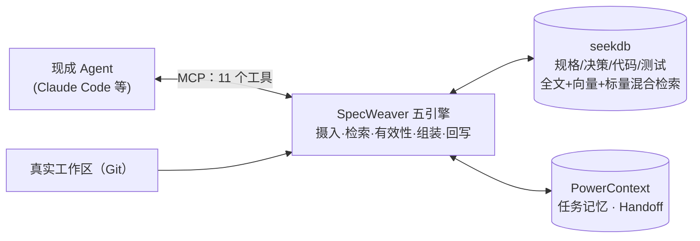

# 一页技术说明：SpecWeaver——规格驱动开发的工程上下文运行层

> MiniMax × OceanBase 赛题「规有所依——面向软件持续演进的 SDD 上下文管理系统」参赛作品 · 2026-10-21
> 深入阅读：《[01-架构设计说明书](01-架构设计说明书.md)》《[03-工程骨架设计](03-工程骨架设计.md)》；全部证据在 `evidence/`

## 问题一句话

在持续演进的工程里，AI 开发助手动手前不知道**当前有效的规格是什么、该看哪些代码和测试、哪些决策已失效**——它凭记忆和猜测改码，错了没人知道。

## 方案一句话 + 架构

**SpecWeaver 是运行时上下文服务**：Agent 动手前，给出当前有效、最小充分、来源可核对的工程依据；任务完成后，把代码变化与验证结果反向织回工程记录，支持跨会话接续。



## 指定组件的实际作用

- **seekdb（存储与检索）**：唯一权威工程资料库——需求/设计/代码/测试/规则结构化入库，全文 + HNSW 向量 + 标量三路混合检索（RRF 融合），版本/状态/模块过滤；`sw_change_set`/`sw_test_run` 承载反向回写的活动证据。
- **PowerContext（记忆与交接）**：决策与约束的 Memory（remember/revise/retire）、Handoff 提交与接续、任务结果回写——只存指向 seekdb 的引用，不独立持有事实，从结构上杜绝双写不一致。
- **SpecWeaver（选手实现，五引擎）**：两者的语义粘合层——任务驱动检索（LLM 意图规划 → 三路召回 → 图扩展）、有效性判定（生命周期状态机 + supersedes 闭包 + 冲突/缺口/过时检测）、字节预算内的上下文组装（每条带 citation 可一键回源）、反向回写、接续前三方核对（Git ref / 文件校验和 / 真实测试结果）。

## 设计取舍

1. **运行时服务，而非改造 Spec Kit**：Spec Kit 是开发期脚手架——其模板被吸收为规格 Schema，运行时骨架自研，存储原生落在两个指定后端上。
2. **五层六边形**：核心域零第三方依赖（可离线单测），seekdb/PowerContext 是可替换适配器，MCP/CLI 只是薄皮。
3. **检索阶段不过滤**：候选集包含被替换版本，有效性判定统一后置——冲突与过时因此**可见**，而不是被检索悄悄藏掉。
4. **预算对交付文本保证**：每条构件计入其 citation 字节，装配后按真实渲染量复裁，不合规必收敛；预算小于裸框架时如实宣告。
5. **标的可插拔**：仓库档案层（specweaver/openspec/plain 三档）隔离布局与方言差异——换标的只换档案，五引擎零改动。

## 实现效果（全部有 `evidence/` 可核对）

| 维度 | 数字 |
|---|---|
| 测试面 | 327 项离线测试全绿 + 真后端集成，语句覆盖 94% |
| 检索质量（金标三方对照） | 生产预算 recall **1.0**（朴素关键词 0.847、官方装配基线 0.208） |
| 双轨真 Agent 冒烟 | railway（Python+pytest）：ON 17 passed；openspec-demo（TS+Playwright，实仓 a05b36d）：ON **44 passed** vs OFF 43，后端侧 326 次调用全链可追溯 |
| 效率 | railway hard 档 ON 中位 46.1s vs OFF 82.3s（-44%）；小仓库上工具开销占优（54.7k vs 46.1k input tokens），已如实声明 |
| 规模成本 | 受控扫描：后端调用随语料增长（18→200 构件 40→350 次）、p95 5.8→9.6s，如实声明不美化 |

## 适用范围

中长期、多人/多 Agent 持续演进、需求频繁变更、强调可追溯与回归验证的工程。不适用：一次性脚本、无测试基线、资料完全无结构且无法补充来源的场景；纯离线时自动建图与语义判定降级为规则模式。

## 五分钟复现

```powershell
git clone <本仓库>; cd SDD
wsl bash specweaver/deploy/wsl/wait_ready.sh        # 起 seekdb + PowerContext（docker）
pip install -e ".[seekdb,powercontext,mcp,cli,server,dev]"
Copy-Item specweaver\.env.example specweaver\.env   # 填推理 key（不填自动降级规则模式，功能链路不变）
specweaver doctor                                    # 自检：两后端连通 + 推理模式
python specweaver/scripts/run_demo.py                # 铁路全链路演示 → evidence/（提供依据→改码→验证→回写→接续）
# 进阶：真 Agent 双臂评测（需 Claude Code 与 Node 环境）
python specweaver/scripts/run_eval.py specweaver/taskpacks/openspec-demo-basic.json --arms on,off --source . --start-backends
```
