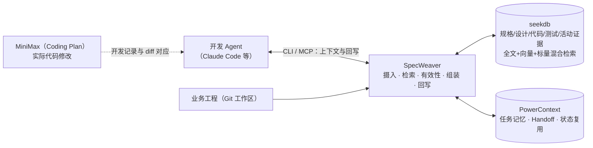

# 一页技术说明：SpecWeaver——面向 SDD 的工程上下文运行层

> MiniMax × OceanBase 赛题「规有所依——面向软件持续演进的 SDD 上下文管理系统」参赛作品 · 正式题面 2026-10-26
> 六项必做合规矩阵与证据索引见 [合规核对.md](合规核对.md)；提交材料见 `minimax/`；全部证据在 `evidence/`

## 问题一句话

AI 开发助手动手前，不知道**当前有效的规格是什么、该看哪些代码和测试、哪些决策已失效**；任务完成后，修改结果与验证也没有写回工程记录，下一次（或下一位接手者）只能凭记忆重来。

## 方案一句话

**SpecWeaver 是运行时上下文服务**：Agent 动手前，给出当前有效、最小充分、来源可核对的规格/代码/测试依据；任务完成后，把代码变化与验证结果反向写回；任务状态经 PowerContext 持久化，**模块重启后可读取并复用**。



## 三项指定技术的实际分工（正式题面 §2.2）

| 技术 | 在作品中的实际作用 | 证据 |
|---|---|---|
| **MiniMax** | 通过 Coding Plan（Anthropic 兼容端点，模型 MiniMax-M2.7）驱动 Claude Code，完成验证样例的**实际代码修改**；SpecWeaver 的规划/向量也使用 MiniMax（M2.7 + embo-01@1536） | `evidence/minimax-dev-20261026-111336/`（上下文、prompt、transcript、diff、改前/改后测试） |
| **seekdb / OceanBase** | 唯一工程资料库：规格/设计/代码/测试/规则结构化入库；全文 + 向量 + 标量三路混合检索（RRF）；变更集/测试运行留痕；上下文中的每个来源都回指库内构件 | `db-powercontext-record.json`（18 artifacts、67 次检索后端调用）、`evidence/railway-*` |
| **PowerContext** | Memory：决策/约束/进度；Handoff：任务交接与接续；**从空状态保存任务记录 → 模块重启 → 新进程读取并用于后续上下文** | `evidence/official-state-reuse-*`、`evidence/railway-*` |

## 六项必做怎么满足（正式题面 §4.1）

| 必做项 | 实现与验证 |
|---|---|
| 1 能够运行 | `doctor` 自检 + `python specweaver/scripts/run_demo.py` 全链路；运行说明含依赖、初始化、入口、测试命令与重置；无 `.env` 时自动降级规则模式，链路不中断 |
| 2 MiniMax 实际参与 | 上表 MiniMax 记录：任务、提供的上下文 Bundle、修改过程、完整 diff、改前/改后测试一一对应 |
| 3 上下文正确 | `get_context` 输出四段（目标与约束 / 设计与实现 / 验证 / 状态与来源）+ 每条 citation；**规格更新并增量重导入后返回新版本内容**（`supersedes` 版本链） |
| 4 数据库实际参与 | seekdb 为上下文唯一来源：检索、有效性核对、回写均经数据库；提供查询入口与数据库记录 |
| 5 状态能够复用 | PowerContext Memory/Handoff 持久化；进程 A 保存 → 进程 B（新进程）`resume` 读取并重建上下文 |
| 6 代码修改有效 | 同一组目标测试：**修改前因目标行为缺失而失败 → 修改后全部通过**；回归测试同时通过；测试集前后一致，未删除/跳过/改预期 |

## 上下文策略与关键取舍

1. **运行时服务，而非改造 Spec Kit**：Spec Kit 的模板被吸收为规格 Schema；运行时骨架与存储原生落在 seekdb/PowerContext 上。
2. **五层六边形**：domain 零依赖；seekdb/PowerContext 是可替换适配器；CLI/MCP 是薄皮；核心引擎可离线单测。
3. **检索阶段不过滤、有效性统一后置**：候选集包含被替换版本，冲突/过时因此**可见**而不是被悄悄藏掉；active 需求/规则做“约束保底”。
4. **预算是对交付文本的保证**：每条构件计入 citation 字节，渲染后复测、循环重裁，默认 8000B 内如实报告。
5. **标的不换引擎**：仓库档案层（specweaver / openspec / plain）隔离布局差异，换标的只换档案。

## 验证样例（railway 教学工程，Python + pytest）

- 任务：为 `schedule`/`api` 增加按站调整发车时间能力，保持既有搜索、占用、发布行为；
- 修改前：目标行为测试 5/5 失败（行为未实现）；工程测试 10 passed；
- 修改后：目标行为 5/5 通过；工程测试 16 passed；隐藏验收 3/3 通过；diff 仅 3 个文件；
- 另两条必做证据：规格更新重导入（`evidence/official-spec-reimport-*`）、状态重启复用（`evidence/official-state-reuse-*`）。

## 运行与复现

```powershell
# 1) 起两个指定后端（Docker；Linux/Windows+WSL2 均可，见 specweaver/deploy/README.md）
# 2) 安装（editable）
.\.venv\Scripts\python -m pip install -e ".\specweaver[seekdb,powercontext,mcp,cli,server,dev]"
# 3) 推理配置是可选的：不配 key 时自动降级规则模式，功能链路不变
Copy-Item .\specweaver\.env.example .\specweaver\.env
# 4) 自检 + 门禁 + 全链路演示
specweaver doctor
.\.venv\Scripts\python .\specweaver\scripts\gate.py
.\.venv\Scripts\python .\specweaver\scripts\run_demo.py
```

## 适用范围与限制（如实）

- 适用：中长期演进、多人/多 Agent、需求频繁变更、强调可追溯与回归验证的工程；
- 不适用：一次性脚本、无测试基线、资料完全无结构且无法补充来源；
- 已知边界：本地 Docker 部署依赖 WSL2/本地镜像（正式提交需按 `minimax/运行说明.md` 在干净环境复跑）；PowerContext 本部署的语义检索受服务端能力限制，语义召回责任在 seekdb 一侧；扩展能力（跨会话恢复自动化、效率对照）不属正式题面必做项、不另行加分。
